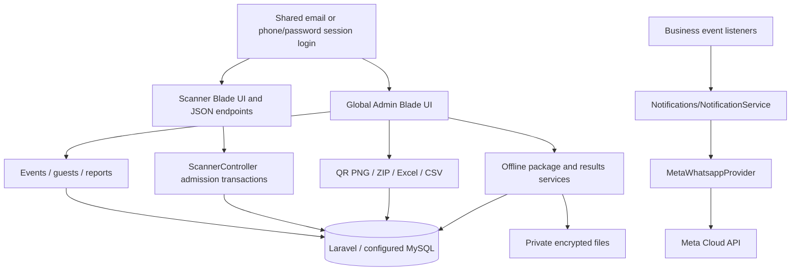
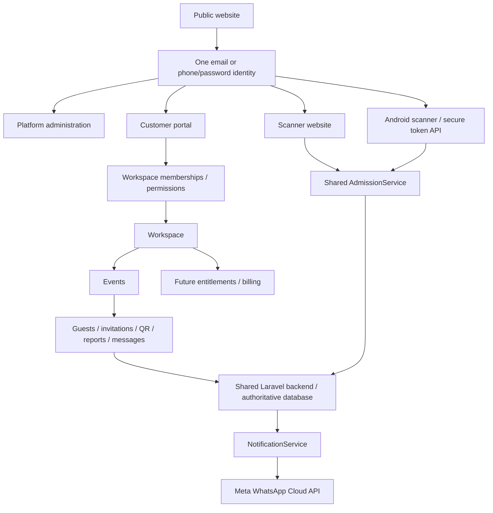
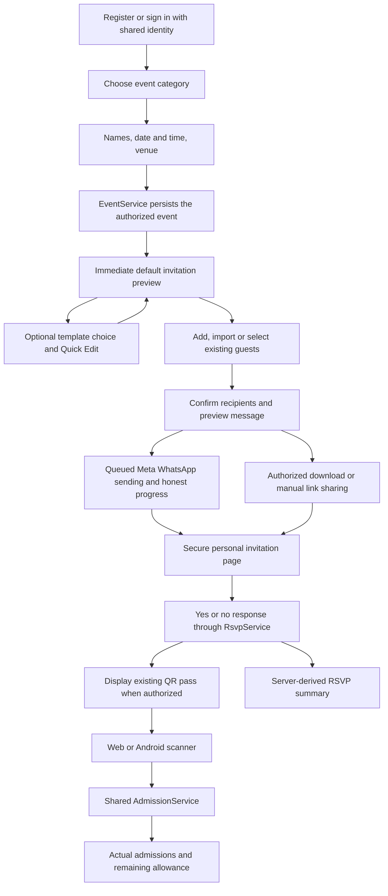

# Kadify architecture

P4-046 completes the read-only [whole-family read/export/media design](LEGACY_READ_EXPORT_MEDIA_DESIGN.md) (2026-11-05). Proposed narrow read projections, buffered media delivery and one shared private-QR storage policy cover existing administrator presentation and its layout/import dependencies. The coupled issuance/deletion disk changes and all runtime integration belong to P4-047. No service, route, disk or schema is installed here; P4-045 remains the implemented 2,288/44,727 gate by exact source preservation. Families 3/4 and Phase4 stay open.

P4-047 slice 1 (2026-11-07, IN PROGRESS) applies the projection rules inside the existing AdminController queries (constrained Guest/scanner decoration, Event-bound relation search/counts, exact selected-Event logs, bound import results), serializes CSV/XLSX before returning the response and constrains the admin-layout banner's creator/package labels. It adds no service class, route, disk or schema; the proposed read/delivery services, private guest_qr storage and prepared layout bundle remain P4-047 work.

P4-047 slice 2 (2026-11-08, IN PROGRESS; independently reviewed, fixes re-reviewed) adds the storage and delivery layer without a route or schema change. `App\Services\GuestQrStorage` is the single policy for the fixed private `guest_qr` local disk (`storage/app/guest-qr-private`): it checks the disk configuration, an existing real root outside every public/linked/served root, the resolved local adapter and its actual root, and exact relative keys, failing with `GuestQrStorageUnavailable`. `LegacyGuestIssuance` and `LegacyGuestDeletion` obtain their disk only from it, after their existing authority and reference checks. `App\Services\Tenancy\LegacyQrMediaDelivery` runs the existing guarded repair, then one read-only locked transaction attempt over the current Event, administrator and complete frozen Guest/QR set, and reads every byte before the controller builds a private no-store response; failures surface as `LegacyQrMediaUnavailable`. There is no public-disk fallback, and moving existing public QR files is a gated operator cutover, not runtime behavior.

P4-047 slice 3 (2026-11-08, IN PROGRESS; independently reviewed and fixed) adds `App\Services\Tenancy\LegacyAdminReadProjection`. Its `layout()` prepares the shared admin layout's selected Event, offline banner and Event switcher before any rendering, in one read-only attempt (shared-lock Event → actor → Session; package, creator and catalogue as unlocked primary label reads), as immutable values with no model or lazy SQL. A view creator registered for every admin-layout view (`LAYOUT_PAGES`) calls it when the page view is made unless the page supplied the values, and the `layouts.admin` composer only consumes them. `PrivateNoStoreResponse` (`admin.private`) applies the private no-store HTML policy to family-3 routes. Slice 4 (2026-11-09) adds the page and export read bundles to the same class: required Event → actor → Session → private rows in primary-key order, then unlocked labels, in one attempt per request, with named indexes and immutable `App\Support\AdminRead` view values. `LegacyQrMediaDelivery` uses shared locks with an unlocked global path check. [Engine observations](MYSQL_READ_BUNDLE_REHEARSAL.md).

P4-045 is COMPLETE in source/tests (2026-11-04) for the existing Guest creation/import, QR generation and image/manual-code repair family. LegacyGuestIssuance freezes canonical context and uses one local mutation attempt with current primary authority, separate rotation/missing-only/repair modes, write-free rendering and guarded strict file effects. Import continuation is limited to a known rolled-back inner failure; authority or uncertain outcomes interrupt privately. Full isolated gate: **2,288 tests / 44,727 assertions**. Family 1 source is accepted; families 3/4, Phase4, actual rollout and all 39 approved UI implementations retain their open gates. [Implemented contract and limits](LEGACY_GUEST_ISSUANCE.md).

Historical P4-043 checkpoint (2026-11-03): P4-043 is COMPLETE in source/tests (2026-11-03) for both existing legacy single/bulk Guest deletion actions. A dedicated one-attempt service validates the entire current Event/admin/offline/Guest/QR/path set and all global shared-path vetoes before resolving public storage or performing deletion effects. Strict false/cancel failures now produce sanitized account-language feedback. Known SQL rollback cannot restore removed bytes; caller transactions, arbitrary callbacks, file provenance and unknown commits retain their explicit limits. Full isolated gate: **2,166 tests / 43,324 assertions**. Customer writers/signup, actual rollout and all 39 approved UI implementations remain gated. [Deletion contract and limits](LEGACY_GUEST_DELETION.md).

Historical P4-044 design checkpoint (2026-11-03): the whole-family issuance contract was reviewed as documentation only, with P4-043 retained by source preservation and no backend rerun. Runtime acceptance arrived separately in P4-045; retain the [reviewed design](LEGACY_GUEST_ISSUANCE_DESIGN.md) as historical scope and dependency evidence.

Historical P4-040 checkpoint (2026-11-02): P4-040 (completed 2026-11-02) protects the four existing legacy Guest/QR activation, deactivation, revocation and restoration transactions. mutateWithQr delegates to the unchanged P4-039 guard, freezing canonical Guest/Event/actor and selected Event identities through the existing three attempts. Its sixth primary locking read selects the current unique QR by guarded Guest ID and checks raw QR identity/parent; cached caller relations supply no authority. No outer transaction, QR generation/file operation or shared service extraction is added. Full source gate: **2,102 tests / 42,558 assertions**. [Contract and limits](LEGACY_GUEST_QR_WRITES.md).

Historical P4-039 checkpoint (2026-11-02; update/cancel only): P4-039 (completed 2026-11-02; started 2026-11-01) protects only the existing legacy single-Guest update/cancel writes. LegacyGuestWrites freezes canonical original/current Guest and actor identities, the explicit selected Event and validated controller payload before the existing three-attempt transaction. Each attempt uses primary current unowned Event → exact active administrator → the unchanged OfflineEventLockService Event reread/blocking-Session check → exact Event-scoped Guest lock/raw postcheck. The successful guard path has five reads. The callback repeats the normalized allowance floor against current used_entries; model/admission/QR behavior remains intact. Full source gate: **2,066 tests / 42,134 assertions**. Trusted callback/caller/commit and actual MySQL schedule limits remain. [Contract](LEGACY_GUEST_WRITES.md).

Additive visual contract (2026-10-30): the 39 approved `reference UI` PNGs define PangaEvents appearance for mapped screens. Backend/security architecture, identity and data remain authoritative; this reference audit creates no UI or customer route. All 39 are inspected and NOT STARTED in approved-design implementation. [39-screen implementation](REFERENCE_UI_IMPLEMENTATION.md); [screen matrix](REFERENCE_UI_SCREEN_MATRIX.md), [shared components](REFERENCE_UI_COMPONENT_MATRIX.md), [visual QA](REFERENCE_UI_VISUAL_QA.md).

P4-038 implements separate one-attempt byte/metadata/audit authority stages with immutable scalar asset context, an actual persisted metadata receipt and a verified full FILE_DELETED audit. No outer transaction or repeated byte operation is added. Full gate: **2,028 tests / 41,407 assertions**. [Implemented scope and limits](OFFLINE_SECURE_DELETE_BOUNDARIES.md).

Historical P4-037 design checkpoint (2026-10-29): P4-037 completes design only for separate metadata/audit authority stages after the implemented byte fence. The planned providers use immutable scalar asset context, an actual primary persisted metadata receipt and a verified persisted FILE_DELETED audit, with exactly one attempt per stage and no outer transaction or repeated bytes. P4-036 remains the implemented1,937/37,724 gate. [Planned contract and limits](OFFLINE_SECURE_DELETE_BOUNDARIES.md).

Historical P4-036 byte-only checkpoint (2026-10-29): P4-036 implements a one-attempt current Event/administrator/Session/Artifact fence around secure-delete bytes through a scoped service and one shared byte primitive. An exclusive trusted provider passes current context to the unchanged later metadata/audit sequence outside that transaction. Full source gate: **1,937 tests / 37,724 assertions**. [Implemented scope and limits](OFFLINE_SECURE_DELETE_BOUNDARIES.md).

P4-034 implements bounded root callback retry artifact cleanup: immutable path/disk/PDO markers, actual callback re-entry, fresh authority and a current any-path committed-reference veto precede cleanup. It adds no general commit/crash recovery. [Implemented contract and limits](OFFLINE_RETRY_ARTIFACT_RECOVERY.md).

Canonical reference; initial audit 2026-10-11, current-state notes reviewed 2026-10-30. [Execution](PROJECT_PLAN.md) · [Evidence](CURRENT_SYSTEM_AUDIT.md).

## CURRENT — verified structure

Kadify is a Laravel event/guest and QR admission monolith, branded inconsistently as Harusi/Wedding QR/Kadify. Legacy administrators manage unowned events in the catalogue/direct metadata controls; selected-event and direct offline entry now require fresh unowned context, while downstream atomic child/offline/file paths still require isolation. Legacy staff management excludes workspace/platform identities; scanner account choices require active unowned events. Scanner accounts have one event assignment. P3-002 prepares workspace/membership storage and nullable ownership in repository migrations/tests; actual rollout and complete tenant policies remain unverified. P4-003 provides an own-workspace home; P4-009 adds bounded empty-workspace setup for existing customers with automatic creator ownership. Customer event/guest portal and public registration remain closed.

Installed stack: Laravel 12.70.0, PHP 8.2.12 CLI, Blade, Tailwind 4, Vite 7, vanilla JavaScript, html5-qrcode, BaconQrCode and PhpSpreadsheet. The backend suite uses SQLite in memory. Selected additional rehearsals used a separate synthetic MySQL 8.4.11 server; the configured customer database/schema/version remains unverified.

**IMPLEMENTED through P2-005 (2026-10-16):** shared email-or-phone sessions, active-account checks, safe redirects/remember support and active new offline enrollment; registered-email password recovery with generic deferred delivery, expiry/single use and old browser/remember revocation. The HTTPS bearer login/me/logout foundation adds explicit token expiry and transactional revocation. Full suite passed **356 tests / 3,117 assertions**. [Task evidence](PROJECT_PLAN.md). Production migrations, mail/hosting, device/visual/bilingual UI remain separate gates; P2-005 cleared all reported locked advisories with 13 compatible package updates. Phase 2 repository gate is complete; P3-001 adds a read-only inventory/preflight tool, P3-002 prepares dormant workspace structures, and P3-003 validates explicit private ownership/platform proposals through a read-only CLI. Actual database, restore and owner mapping remain unverified.

Existing application/scanner routes retain web sessions and CSRF. Three /api/v1/auth routes use HTTPS bearer tokens; browser and API identities remain independent. Native Android client/scanner API functionality remains planned. Server-side offline file protocols exist; Android/master/slave networking remains unverified. See [scanner](SCANNER_ARCHITECTURE.md) and [sync](OFFLINE_SYNC.md).

## CURRENT — latest source and isolated verification

P4-030/P4-031 remain the upload head-write checks. P4-034 now cleans known prior root callback rollback artifacts only on a later authorized callback, with a positive any-path reference veto and captured-disk cleanup. P4-032 observations and P4-033 design remain historical evidence. [Outcomes and limits](OFFLINE_UPLOAD_FILE_EFFECTS.md).

Current source gate: **2,567 tests / 46,329 assertions** (P4-047 slice 4, in progress), 100 registered routes and 32 inventory tables; the latest completed-task gate is P4-045 at 2,288 / 44,727. P4-045 accepts whole-family Guest create/import/QR generation/repair source preparation; P4-043 deletion and earlier metadata/offline checks retain their separate contracts. Families 3/4, complete tenant isolation, customer Event exposure and actual ownership/restore/deployment remain open. [Implemented issuance](LEGACY_GUEST_ISSUANCE.md); [status](PROJECT_STATUS.md).

## HISTORICAL IMPLEMENTATION — P4-036 secure-delete byte authority (2026-10-29)

P4-036 routes both existing destroy actions through LegacyOfflineSecureDeletion::delete with explicit selected Event and canonical original/current Artifact, Session, Import Event and actor identities captured before queries. It freezes exact raw path/disk and the resolved fallback disk before the composed-helper hook. Its trusted optional byte-context provider uses exactly one default-connection transaction attempt: primary selected unowned Event → current exact active administrator → captured Session → Artifact. SQL namespace predicates constrain unowned Event, Session Event and Artifact parent/Import Event before full model hydration; raw post-hydration identity/parent/path/disk checks remain. Undeleted state is checked before bytes.

The shared FileStorage deleteEncryptedArtifactBytes primitive preserves private path/disk, missing-file and false/throw behavior and intentionally rechecks the existing global retention enable flag at the byte point. The provider performs the byte phase and returns current resource/Session/actor/path/disk. Provider and direct branches are exclusive: no ordinary parent reload, fallback on provider error, disk recalculation or second unlink follows provider success. Without a provider, trusted direct helpers retain their existing composition and named outcomes, with the added shared byte-point retention recheck. No age, archive or lifecycle prerequisite is introduced.

Only the byte phase is fenced here. The existing metadata UPDATE → audit INSERT → final fresh() tails remain outside the new byte transaction and unchanged. Current authority for those later writes is not implemented by P4-036. Under normal HTTP autocommit, metadata refusal still loses bytes without metadata/audit, and audit refusal still loses bytes while retaining committed metadata. An enclosing caller transaction still changes SQL commit/rollback scope; unlink remains irreversible. Both destroy actions now pass late HttpExceptionInterface403/404 through before their RuntimeException catch; success/validation behavior and generic storage/SQL feedback remain. No retry around unlink is added.

Boundary36/846, deletion compatibility17/353, workflow11/189, focused836/16,380 and full1,937/37,724 pass; all86 prior classes are conserved. R33 is only partly mitigated at the byte phase; current authority for metadata/audit and shared-path/provenance, commit and recovery limits remain open. [Evidence](OFFLINE_SECURE_DELETE_BOUNDARIES.md).

## IMPLEMENTED — P4-034 bounded retry artifact cleanup (2026-10-29)

P4-034 implements bounded cleanup for artifacts from a failed root transaction callback only after this invocation actually enters a later retry. Each callback resets its current cleanup path/disk before guards; immutable marked attempts retain their path, disk and actual PDO. Registration occurs only in the callback catch with root entry, level1, same-PDO and an open physical transaction. The rollback callback only marks local state. A later callback rechecks the current Event → active administrator → Session prefix and root/PDO identity before cleanup.

Before touching a prior file, a current primary locking ID-only Import lookup vetoes ANY matching encrypted_file_path, without Event or disk filtering or foreign private Import hydration. The captured disk selects the file. A missing file is tolerated; false/throwing deletion stops before another put. Storage exceptions are wrapped with a fixed nonconcurrency message so Laravel cannot silently retry them as database contention. No outer transaction, global listener, artifact scan or retention/quarantine policy is added.

Boundary17/783, workflow11/189, focused800/15,534 and full1,901/36,878 pass; all85 prior classes retain exact counts/assertions. The final catch remains limited to its current attempt/captured disk and is not an unknown-commit reconciliation path. Unmarked earlier successful-callback/commit-error artifacts remain outside the new repair. [Verification and remaining limits](OFFLINE_RETRY_ARTIFACT_RECOVERY.md).

## HISTORICAL OBSERVATION — P4-032 preview retry files (2026-10-28)

P4-032 confirms a deterministic callback-rollback/retry artifact gap in the unchanged preview source. At actual transaction level0 on SQLite :memory: with fake private storage, a child INSERT trigger fails after a successful file put. A synthetic `database is locked` message is recognized by the installed Laravel concurrency detector and retries the callback after SQL rollback. Success on retry2 leaves one earlier unreferenced attempt file beside the committed file; three failed attempts leave two earlier unreferenced files after only the final path is cleaned. An ordinary nonconcurrency refusal takes one attempt and leaves no attempt artifact.

The external TEMP probe passed **3 cases / 269 assertions**. All353 source fingerprints and363 unrelated non-doc paths are preserved; the regular **1,884 tests / 36,095 assertions** P4-031 gate is retained without rerun. No cleanup policy or production recovery is implemented; uncertain commit and deletion outcomes remain separate. [Evidence](OFFLINE_UPLOAD_FILE_EFFECTS.md).

## IMPLEMENTED — P4-031 preview storage authority (2026-10-28)

storePreview now captures canonical original/current Session PK/Event and actor identities, explicit selected Event and validated envelope Event equality before its transaction. Captured IDs remain fixed across its existing three attempts. Inside that same transaction and cleanup catch, primary locks run Event → current active exact administrator → Session; the Event must remain unowned and the Session must retain the captured Event. Platform and workspace-linked administrators retain existing eligibility. Package/session-user relations load only after these head checks, and all preview references/audits use the current locked actor and Session.

Full gate: **1,884 tests / 36,095 assertions**. Existing malformed locked-Event validation is preserved; canonical head mismatch is404 and current actor loss403. Preliminary audit persistence remains independent under normal HTTP autocommit. File placement/retries and the cleanup catch remain in their original boundary; this does not establish artifact recovery or complete tenant isolation. [Evidence and limits](OFFLINE_UPLOAD_FILE_EFFECTS.md).

## IMPLEMENTED — P4-030 preliminary upload audits (2026-10-28)

LegacyOfflineUploadAudits validates canonical original/current Session/Event and actor identities plus explicit selected Event before queries. Each external Uploaded, VerificationFailed or Reimport audit uses its own default-connection transaction with primary Event → current active exact administrator → Session locks. The Event must remain unowned and the Session must retain the captured Event. Platform and workspace-linked administrators retain existing eligibility and the generic audit format is unchanged.

verifyUpload now receives selected Event from the existing controller and uses the guarded current Session/actor instead of default-read fresh() substitution. Failed validation and the external duplicate attempt recheck authority before their audit insert. Late ownership/parent mismatch 404 and administrator eligibility 403 pass through the preview controller's broad catch. Authorized invalid files retain normal validation feedback and legitimate audit traces. No outer upload/preview transaction was added: under normal HTTP autocommit, preliminary audits persist independently of preview success. An existing caller transaction may still enclose them; these are not autonomous commits.

Full gate: 1,871 tests / 35,732 assertions. Preview records/files, internal duplicate handling and recovery remain separate. [Evidence](OFFLINE_SYNC.md).

## IMPLEMENTED — P4-028 sibling processing (2026-10-28)

Resolver actions that update siblings now select only identity/status columns of the current OPEN sibling set on primary, lock in ascending PK order, validate canonical raw Event/Import/Log links and exact OPEN status, then freeze those IDs before Guest/action effects. The query deliberately has no Event prefilter: a preexisting inconsistent child rejects the whole operation rather than being silently ignored or repaired. The later bulk update targets only frozen IDs and repeats Event/Import/Log/open predicates. Literal-null Log and escalation paths skip siblings, retaining their existing behavior; resolved history and unrelated Import/Log records remain outside this write set. Newly inserted or changed rows stay OPEN, and authoritative readiness checks keep the Import/Session pending.

Full gate:1,855 tests /35,450 assertions. This preserves the admission algorithm and does not certify every engine schedule or file recovery path. [Scope and evidence](OFFLINE_SYNC.md).

## IMPLEMENTED — P4-027 Guest/replacement processing (2026-10-27)

Resolver bound-Guest and replacement lookups now use canonical raw/input IDs and the validated raw Event. A shared lockedGuestInEvent helper retains the Guest lock phase through an ID-only primary existence read, preserving missing-record exception and wrong-Event validation behavior without loading foreign Guest details. Current Guest models are queried only in that Event and their raw PK/Event are rechecked before the existing QR relation is loaded on primary. Both action paths use this helper; there is no new pass, token or admission algorithm. Existing Single/Double/Family capacity, history, manual-count and literal-null rules remain intact.

Full gate:1,845 tests /35,060 assertions. Sibling, atomic QR and internal-history boundaries remain separate. [Scope and evidence](OFFLINE_SYNC.md).

## IMPLEMENTED — P4-026 bound-Log processing (2026-10-27)

The existing OfflineScannerImportConflictResolver now parses canonical raw caller Conflict identity before its transaction, removes blind initial Log/parent eager loads and validates current locked raw Conflict/Import/Session/Event context before subsequent numeric lookups. It retains Conflict → Import → Session → Log lock phases and the existing transaction/retry count. A literal null bound-Log FK preserves existing no-Log actions; every non-null key must be canonical and resolve to a primary locked Log in the same Import and Session, with raw IDs rechecked after hydration. Unsafe/missing/foreign/mismatched Logs fail through generic conflict_resolution validation before effects. Explicit safe/null importedLog and parent relations ensure manual adjustment uses the validated locked Log.

Full gate:1,830 tests /34,829 assertions. Existing action/admission methods remain unchanged; Guest/replacement and sibling effects remain separate. [Scope and evidence](OFFLINE_SYNC.md).

## IMPLEMENTED — P4-025 conflict-resolution authority (2026-10-27)

LegacyOfflineConflictResolution validates canonical raw original/current Conflict, Import/Event references, selected Event and actor identity before queries. It captures only primary Import identity metadata to choose a canonical Session, then freezes that parent across retries. Its outer default-connection transaction locks Event → current User → Session → Import → Conflict, requiring the captured unowned Event, exact active administrator and all captured parent links. Platform and workspace-linked administrators retain existing eligibility. The unchanged resolver runs on the same connection with its existing lifecycle/action/admission rules. Late head/ownership and actor changes pass through as generic404/403; resolved-conflict HTTP403 remains unchanged.

Full gate:1,811 tests /34,505 assertions. Bound-log/Guest/sibling processing and actual rollout remain separate. [Scope and evidence](OFFLINE_SYNC.md).

## IMPLEMENTED — P4-024 confirmation authority (2026-10-27)

LegacyOfflineResultConfirmation now checks canonical raw original/current Import, Session/Event references, selected Event and actor identity before database work. Its outer default-connection transaction locks primary Event → current User → Session → Import. The captured Event must remain unowned; the actor must remain an exact administrator with known true activity; all captured parents must still match. Platform and workspace-linked administrators retain existing legacy eligibility. The unchanged importer runs on the same connection with its existing reconciliation, lifecycle/capacity/history checks and completed internal no-op. The completed HTTP request still returns its existing403; late ownership/parent and actor refusals pass through as generic404/403.

Full gate: 1,788 tests / 34,141 assertions. Other result/resolver/upload/file boundaries and actual rollout remain open. The underlying reconciliation algorithm is preserved. [Scope and evidence](OFFLINE_SYNC.md).

## IMPLEMENTED — P4-023 current scanner review projections (2026-10-27)

LegacyOfflineScannerReview handles six authorized setup/Session/result/conflict HTTP GET graphs. Canonical raw parent/child IDs and bound conflict-log agreement precede primary current User lookup. Current models require the validated Event, byte-exact scanner role, known false platform flag and no workspace membership. Inactive ordinary local scanners remain readable in history; new-package active-only eligibility is unchanged. Explicit safe/null relations replace preloaded values while canonical historical scanner/filter IDs and captured metadata remain intact; only unsafe noncanonical FKs are masked in memory. Full gate: 1,764 tests / 33,752 assertions. Actor policy, internal returns, arbitrary historical metadata and current authority/concurrency fences remain separate; this adds no whole-tenant privacy fence or UI/RSVP implementation. [Behavior and evidence](OFFLINE_SYNC.md).

## IMPLEMENTED — P4-022 historical Guest review projections (2026-10-26)

LegacyOfflineGuestReview runs after existing legacy head/permission checks for result show/logs/conflicts and conflict detail. It validates canonical raw Import/Session/Event and child lineage, assigns only Event-scoped current Guest/replacement relations, and masks unsafe/unavailable current FKs in clean in-memory projections. Stored server-state/scalars display only with matching canonical attribution; valid own-Event history survives movement/deletion. Database history/private files remain intact. Full gate: 1,748 tests / 29,947 assertions. Internal return graphs, scanner/actor references, arbitrary historical text, broader nested history and current authority/concurrency fences remain separate. This adds no UI/RSVP implementation. [Behavior and evidence](OFFLINE_SYNC.md).

## IMPLEMENTED — P4-021 confirmation Guest references (2026-10-26)

Confirmation validates canonical raw locked Session/Import Event identities before processing, reads snapshot guest_id before integer casting and limits current Guest/QR processing models to that Event. An ascending ID-only existence lock phase retains moved-Guest classification with null foreign current state in new conflicts. All final-count targets use the same raw-ID lookup, covering a two-preview path with no current log for the moved Guest. Full gate: 1,732 tests / 28,538 assertions. Existing returned/review eager relations and old stored state remain separate; this does not add current actor/Event ownership fences or actual MySQL schedule evidence. [Reconciliation scope](OFFLINE_SYNC.md).

## IMPLEMENTED — P4-020 preview Guest references (2026-10-26)

New offline preview Guest models/QR state are limited to the locked Session Event. A shared strict positive-ID parser protects preview/review resolution; moved exported guests receive an ID-only WRONG_EVENT distinction without copying foreign current state into new records. Raw Session Event validation precedes preview rows/files; preliminary audits and existing transaction/file behavior remain unchanged. Full source gate: 1,720 tests / 28,050 assertions. This does not establish current-actor/Guest-movement fencing or repair historical stored relations. [Details and limits](OFFLINE_SYNC.md).

## TARGET — mandated SaaS boundaries

Staff operate the platform; customers operate events. Workspace permissions and scanner assignments are separate. Invitation rendering owns layout/export and reads authoritative guest identity, QR and manual code. Billing follows proven tenancy and self-service. See [migration](SAAS_MIGRATION_PLAN.md), [auth](AUTHENTICATION_ARCHITECTURE.md), [tenancy](MULTI_TENANCY.md), [studio](INVITATION_STUDIO.md).

## TARGET — customer invitation, RSVP and admission journey (2026-10-25)

This additive requirement fits within the existing Phase 4 authorization sequence and rollout gates. Its documentation integration does not deliver the customer flow. All eight supplied reference screenshots were examined; only the application inside the demonstrated phone informs the interaction hierarchy. The project plan records the current source task. [Screen mapping](REFERENCE_UX_FLOW.md) · [sequenced work](phases/CUSTOMER_EXPERIENCE_INTEGRATION.md).

Category selection is separate from the planned 100-template catalogue. A professional default from the same versioned invitation engine gives the first preview; advanced layout editing remains optional. Persist event details before rendering and resume the same event/design after guest import or back navigation. Use original Kadify visuals, Kiswahili by default and English resources throughout.

Reuse current Event/Guest/QrCode records, import readers, QR/image/code services and Notifications/NotificationService. EventService, GuestService/GuestImportService, InvitationService/InvitationRenderService, RsvpService, EventReportService and shared AdmissionService are target responsibilities, not claims of existing classes. Extract current controller logic only in its scheduled phase; do not introduce a parallel guest, identity or admission system. Existing admission behavior is distributed across ScannerController, Guest rules and offline importer/conflict logic; OfflineScannerAdmissionApplier writes historical admission/checkin rows. Shared backend unification remains planned.

Invitation delivery, RSVP intention and admission usage have separate authoritative records and counters. Existing-pass behavior stays the default: an unanswered or declined RSVP does not revoke, regenerate or consume a QR pass. An explicitly configured future RSVP-controlled ticket release governs presentation; any change to admission eligibility needs its own approved migration and web/Android/offline contract. A guest invitation capability is distinct from the admission QR and discloses only its exact event/guest data. [RSVP, ticket and persistence contract](RSVP_AND_GUEST_TICKETS.md).

Owner actions authenticate, check active workspace membership, event lineage and operation permission; queue workers repeat authorization. Guest access resolves a hashed opaque capability with expiry/revocation, rate limits and protected media. Meta acceptance is not delivery; verified webhook statuses alone establish delivery. No SMS provider is introduced. [Messaging](WHATSAPP_INTEGRATION.md) · [API proposals](API_CONTRACT.md) · [database rules](DATABASE_CONVENTIONS.md).

## Critical rules

- All interfaces inherit the [product-wide simplicity standard](DESIGN_SYSTEM.md): consistent original Kadify visuals, clear task hierarchy, essential fields first, predictable navigation and recoverable feedback across public, auth, customer, admin, scanner, reporting, settings, billing and future modules. Adapt layouts to their task; shared RSVP-inspired simplicity does not mean repeating the RSVP screen everywhere. Preserve authorization, pass semantics and necessary decision information. Apply through existing implementation phases.
- Preserve IDs, tokens, four-character codes, admissions and scanner website behavior with additive backed-up migrations.
- One identity/password; web sessions, revocable Android tokens; no paid per-login OTP.
- Authorize active account, membership, permission, workspace/event/resource ownership on every protected request. Selected context and client IDs are not authorization.
- One admission implementation with transactions and locks; never exceed allowance. Future retry idempotency must persist outcomes.
- Meta secrets remain server-side. Protect exports, invitation media and offline packages; public QR storage is a current risk.
- Disconnected devices cannot guarantee universal duplicate prevention. Preserve pending logs and reconcile conflicts explicitly.
- Use verified hosting capacity. cPanel cron/workers have not been established.

## CURRENT — reuse map

| Boundary | Existing implementation | Gap |
|---|---|---|
| Identity | AuthController, User, LoginIdentifier, active/password-session middleware, recovery controller/broker | Actual migration/mail/hosting/device verification |
| Workspace foundation | Workspace/User/Event relations, inactive memberships and protected platform flag | Dormant schema only; tenant/platform enforcement and verified ownership remain open |
| Migration inventory | LegacyDataInventory/tenancy:preflight and explicit OwnershipManifest/tenancy:ownership-preflight | Bounded aggregate checks only; actual ownership/backup/engine proof remains open |
| Guests/import | AdminController, GuestImportExcelReader, ExcelExportService | Tenant-scoped service extraction only as needed |
| Phones/codes | PhoneNumberService, ManualCodeService | Align canonical account/guest storage |
| QR | QrCodeService, GuestQrImageService, QrTokenCanonicalizer | Protected media and tenant checks |
| Admission | ScannerController, OfflineScannerAdmissionApplier | Shared AdmissionService; online idempotency |
| Offline | Session/lock/audit, snapshots, canonical JSON, signing/encryption, files/export/validation/import | Secure unlock; real Android interoperability |
| Messaging | App/Services/Notifications/NotificationService, MetaWhatsappProvider, NullWhatsappProvider, listeners | Signed status webhook, retries/usage |
| Reporting | AdminController event queries/CSV, ExcelExportService | EventReportService only when justified |
| Invitations/billing | DigitalCardReady event hook | Renderer/designs/assets/exports; entitlements later |

AuthenticationService, WorkspaceService, AdmissionService, invitation renderer and entitlement service do not exist in the audit baseline. Target names describe responsibilities; inspect before creating abstractions.

Other references: [security](SECURITY_MODEL.md), [design](DESIGN_SYSTEM.md), [deployment](DEPLOYMENT_CPANEL.md), [decisions](README.md).

## IMPLEMENTED — P3-004 source/test update (2026-10-18)

P3-004 prepares a private canonical OwnershipPlanIdentity and two empty resolution-ledger tables. The inventory now counts 31 known tables; no writer, approval, ownership/grants or authorization change exists. Stable resolution alone does not establish resumable event/member/platform writes. [Guide](OWNERSHIP_LEDGER.md).

## IMPLEMENTED — P3-005 source/test update (2026-10-18)

P3-005 adds an unreferenced transactional workspace-preparation service with strict schema/readiness guards and fixed safe errors. It has no command, route, job, listener or config activation. All verified writes are independent SQLite fixtures, with inactive owner memberships and unchanged legacy authority. Actual ownership/restore/engine/fencing remain open. [Guide](WORKSPACE_BACKFILL_PREPARATION.md).

## IMPLEMENTED — P3-006 synthetic MySQL evidence (2026-10-18)

P3-006 adds separate synthetic MySQL8.4.11 migration/backfill/selected-lock/restart/SQL-restore evidence and repairs historical offline index replacement order. The writer remains unreachable; configured/customer DB and real owner/restore/fencing gates remain open. [Rehearsal scope and evidence](MYSQL_REHEARSAL.md).

## IMPLEMENTED — P3-007 read-only progress inspection (2026-10-19)

The new tenancy:backfill-inspect command observes an explicit private proposal against unstarted, retained empty-plan, partial and exact ledger state. Shared exact state validation preserves dormant writer checks/locking/commit/raw-ID semantics; the bounded local manifest reader is shared with ownership-preflight without changing that command. Inspection has no writer dependency, apply call, transaction, row lock, mutation, grant, activation or approval option. Results are multi-query observations, not a consistent snapshot, retry guarantee, legitimate-owner approval, backup evidence or maintenance fence. All four external gates stay unverified and rollout_ready=false. No configured/customer database, actual owner/platform grant, runtime writer, HTTP/API/UI/dependency/Android change or deployment was involved. Phase 3 remains IN PROGRESS. [Scope and usage](BACKFILL_PROGRESS_INSPECTION.md).

## IMPLEMENTED — P3-008 dormant authority context (2026-10-19)

AuthorityContextResolver performs fresh primary reads on an explicit connection and strict positive PHP integer user/optional workspace IDs. It independently observes canonical active-account eligibility, explicit platform capability and the exact requested active owner/manager membership. It has no runtime caller, action-permission API, default selection, grant, activation, policy wiring, write, transaction or lock. Observed facts are not authorization or an unforgeable token. Current admin/scanner account-role compatibility is preserved; Manager action permissions, platform support bypass, ownership transfer/last-owner rules and runtime tenant enforcement remain undefined. Visibility follows the explicit connection and caller transaction/isolation; fresh queries do not fence concurrent changes or invalidate an already retained context. Real ownership/platform approval, customer restore, membership activation, maintenance fencing and Phase4 action/resource policies remain open. Phase3 remains IN PROGRESS. [Scope and verification](AUTHORITY_CONTEXT.md).

## IMPLEMENTED — P3-015 default demo seeder (2026-10-20)

The default seeder is restricted to exact local/testing environments and six empty sample-data targets. Primary existence checks and original sample inserts share one transaction; destructive resets and FK toggles were removed. Full isolated regression passed 849 tests / 13,574 assertions. This does not establish database identity, revoke existing demo accounts or guard separate recovery writers. [Scope](DEMO_SEEDING.md).

## IMPLEMENTED — P3-016 synthetic MySQL seeder evidence (2026-10-20)

Sixteen selected actual MySQL 8.4.11 cases establish default-seeder environment/target refusal, original samples, repeat conservation and injected failure rollback/retry across two fresh InnoDB fixtures. No application source changed; the 849-test / 13,574-assertion source gate was retained after preservation checks. Concurrent/hosted behavior, existing accounts and separate recovery writers remain outside this evidence. [Scope](MYSQL_DEMO_SEEDING_REHEARSAL.md).

## IMPLEMENTED — P3-018 recovery/token engine evidence (2026-10-21)

Four selected actual MySQL recovery/device-login schedules with eight independent HTTP workers verified user-row serialization, target-only credential/token changes and interrupted-reset rollback/retry. No application source changed; the 849-test / 13,574-assertion source gate was retained after preservation checks. Deployment/CSRF/shared-session/SMTP/external-listener effects and all other schedules remain outside this evidence. [Scope](MYSQL_RECOVERY_REHEARSAL.md).

## IMPLEMENTED — P3-019 recovery writer guard (2026-10-21)

The legacy recovery --apply script now refuses outside exact effective local/testing environments before input/DB/hash work. The original parser/dry-run/writer body is otherwise preserved; 21 CLI cases and full 870 tests / 13,976 assertions passed. No configured database recovery occurred and no production provisioning workflow is provided. [Scope](RECOVERY_SCRIPT_SAFETY.md).

## IMPLEMENTED — P3-020 recovery CLI inputs (2026-10-21)

Recovery input resolution now rejects absent/empty/repeated values and requires CSV files plus a QR directory before reading. Existing environment guard/parser/writer behavior is preserved. Twelve added CLI cases and full 882 tests / 14,272 assertions passed; no actual recovery occurred. [Scope](RECOVERY_SCRIPT_SAFETY.md).

## IMPLEMENTED — P3-022 creator-owned setup

The dormant [workspace provisioner](WORKSPACE_PROVISIONING.md) atomically creates a new workspace, active creator owner and private replay receipt. It has no runtime caller and changes no account/event/global authority. New customers will own workspaces they create without developer files; legacy unmapped events stay private. Customer identity and tenant policies precede portal/registration exposure. 938 tests / 15,017 assertions passed in isolation; actual configured rollout remains unverified.

## IMPLEMENTED — P4-001 access observations

A dormant [five-action workspace/event reader](WORKSPACE_ACCESS.md) now checks fresh primary membership and exact event parents, with no global/platform bypass. It is not wired into existing routes and does not establish complete tenant isolation. Full source gate: 976 tests / 17,366 assertions. Customer identity, every resource/file and legacy global-path isolation remain subsequent tasks.

## IMPLEMENTED — P4-002 guest/QR observations

The [dormant guest/QR reader](GUEST_ACCESS.md) extends selected event observations with explicit complete workspace/event/guest/QR lineage. It selects identities only and has no route/file/writer caller. Full source gate: 1,011 tests / 19,736 assertions; complete runtime tenant isolation remains open.

## IMPLEMENTED — P4-003 customer web mode

[Customer identity](CUSTOMER_WEB_IDENTITY.md) is separate from admin/scanner account modes and workspace owner/manager membership. Session auth/recovery supports it; device-token eligibility does not. GET /customer exposes only own active memberships through an independent EN/SW view. Legacy staff cannot inspect/rewrite customer identities through user CRUD. No signup or customer writer is added. 1,071 tests / 20,461 assertions passed; global event/file isolation and real rollout gates stay open.

## IMPLEMENTED — P4-004 legacy event catalogue boundary

Legacy event catalogue and statistics now include only events with workspace_id exactly null and SQL-bounded event IDs from 1 through PHP_INT_MAX before Eloquent hydration. The admin layout uses primary filtered event queries for its selected title and active switcher; invalid/noncanonical selected IDs are ignored without rewriting the session. Direct edit/update/select/archive/cancel reread the event on the primary and return 404 for workspace-owned targets before validation or navigation changes, even when the admin is a workspace owner or has the platform flag. Bound raw identities must be canonical positive PHP-range integers before casting. Update/archive/cancel repeat null ownership on a locked fresh row inside the mutation transaction. Legacy create/update ignore submitted ownership and preserve ordinary unowned controls; no global Event scope or ownership reassignment was added.

This does not complete legacy selected/offline/file enforcement. 1,110 tests / 21,253 assertions passed. [Scope and remaining paths](LEGACY_EVENT_ADMINISTRATION.md).

## IMPLEMENTED — P4-005 context entry checks

A shared LegacyEventResolver accepts only positive PHP integers or canonical decimal strings within PHP range, reads the primary for exact null-owned events and verifies raw identity/ownership before returning a model. Missing/error/unsupported targets return null without writes, logs or default creation. soleActive uses a primary null-ownership/active/ID-range query capped at two and succeeds only for exactly one safe event. Explicit selected keys, including null, must resolve safely; invalid/missing/deleted/owned targets clear selected_event_id and the entire guest_import state and redirect without silently switching events. Only an absent key may auto-select the sole safe active legacy event; absent context also clears stale import state when no choice is possible. Valid selected legacy lifecycle states remain compatible.

AdminController independently checks current event and import preview again before using resource or cached import context; lost/owned/ambiguous state returns404 and clears selection/import without defaultEvent fallback. Direct offline create/store resolve the bound raw event ID afresh before context mutation, validation, snapshots or package generation, and use the returned current model. Private/missing/unsafe bound targets404 without context or package effects. Explicit event creation/selection/current clearing and valid offline entry discard guest_import on an actual context change, preserve it for canonical same-event navigation and retain unrelated workspace/session state. No customer or platform/member bypass is introduced.

1,172 tests / 21,736 assertions passed in isolation. Complete offline/child/file fences and real rollout remain open. [Scope](LEGACY_SELECTED_EVENT.md).

## IMPLEMENTED — P4-006 legacy credential boundary

Legacy staff account management now excludes every workspace-linked or platform target, including inactive membership rows and scanner/admin identities assigned to owned events. Targets require a safe canonical positive PHP-range raw user ID, exact admin/scanner role, known-false raw platform flag, no membership of any state and either null assignment or an actual safe unowned event. The primary catalogue applies these predicates before pagination and constrains its eager event relationship to safe unowned parents. Direct read/write targets are refreshed before validation; an actor's platform flag or memberships never bypass the target boundary. Inactive ordinary legacy accounts remain manageable.

Store explicitly supplies the eligible scanner event and locks its parent before inserting the User, avoiding the unchanged model default hook. Update/delete capture the old assignment, lock deduplicated old/proposed Events in exact ascending integer order, then lock User. They recheck raw identity, exact role/false platform flag and unchanged old assignment, followed by a current locking membership-row read. Assignment drift denies instead of taking a newly discovered Event lock after User. Only then do account/credential/token writes occur in the same transaction. Existing password hashing, remember-token rotation on password reset, token revocation and rollback remain intact.

1,240 tests / 22,336 assertions passed in isolation. Engine contention and remaining offline/scanner/file boundaries stay open. [Scope](LEGACY_STAFF_ACCOUNTS.md).

## IMPLEMENTED — P4-007 selected staff transaction evidence

All **four selected actual MySQL 8.4.11 cases / nine independent PHP workers** passed. Three waits were observed through performance_schema with exact requesting/blocking connection IDs, schema/table, PRIMARY index, WAITING RECORD state and canonical target key (Event301 or User221). Every synthetic schema applied the frozen 28 repository migrations and had 32 tables. Whole-fixture snapshots and table definitions were conserved outside the exact allowed changes; allocator counters were excluded from schema comparison and their restoration is not claimed.

P4-006's 1,240 tests / 22,336 assertions source gate is retained by exact source/test preservation. No runtime path changes. Complete offline/scanner/file isolation and real rollout remain open. [Scope](MYSQL_STAFF_REHEARSAL.md).

## IMPLEMENTED — P4-008 automatic owner engine readiness

All **10 actual MySQL 8.4.11 cases / 13 independent service workers** passed, including 12 serial observations, three exact creator-row waits, interruption after each completed insert and three actual unsigned allocator cases. Eight fresh synthetic schemas applied the frozen 28 repository migrations and contained 32 tables. The complete P4-006 **1,240 tests / 22,336 assertions** source gate is retained by exact source/test preservation; no new backend suite run is claimed for this TEMP/docs-only task.

Automatic creation uses the eligible creator as the new workspace's active owner and never adopts existing same-name events/workspaces. The service remains internal; a bounded authenticated setup caller and remaining resource isolation are future work. [Scope](MYSQL_WORKSPACE_PROVISIONING_REHEARSAL.md).

## IMPLEMENTED — P4-009 customer workspace setup (2026-10-23)

Existing authenticated customers now create an empty workspace through two protected HTML routes and automatically become its active owner. Exact customer role is rechecked under the creator lock before creation/replay; submitted ownership/global fields grant no authority. Matching retries add no rows and failed inserts roll back. Full isolated source gate: **1,275 tests / 22,874 assertions**. Event/guest writers, signup and complete tenant isolation remain closed; no configured data or deployment changed. [Setup contract and verification limits](CUSTOMER_WORKSPACE_SETUP.md).

## IMPLEMENTED — P4-010 offline parent request-entry checks (2026-10-23)

Offline session/package/import/conflict controller actions now resolve fresh exact selected unowned Event chains before policies, payloads, validation and effects. Preview and generated-package references are checked before file/form work. Full source gate: **1,324 tests / 23,668 assertions**, with 100 unchanged routes. These joined primary observations do not fence later transactions/files or certify nested guest/scanner references. Customer event/signup exposure and real rollout remain closed. [Scope and evidence](LEGACY_OFFLINE_RESOURCES.md).

## IMPLEMENTED — P4-011 locked legacy package generation (2026-10-23)

Package generation now locks the unowned Event, sorted eligible actor/scanner Users and current scanner memberships before snapshots or generation effects. Scanner choices/validation exclude workspace/platform identities; late parent/actor denial and private database-error feedback remain safe. Existing transaction/crypto/payload/compensation logic is retained. Full source gate: **1,372 tests / 23,870 assertions**. Actual MySQL schedules and postcommit/later offline/file boundaries remain separate. [Scope](LEGACY_OFFLINE_PACKAGE_GENERATION.md).

## VERIFIED — P4-012 package-generation engine checks (2026-10-23)

All **six actual MySQL 8.4.11 case groups / nine independent service workers** passed, including twelve serial observations and four exact row waits. Six fresh synthetic schemas each applied the frozen 28 repository migrations and contained 32 tables. The P4-011 **1,372 tests / 23,870 assertions** source gate is retained by exact application/test fingerprints; no new backend suite run is claimed for this TEMP/docs-only task.

Selected Event/User waits, a current membership read after a caller RR absence snapshot, committed production generation before transfer and real driver-failure row/file compensation passed. All configured data/services are preserved and the owned server/credentials are cleaned up. Postcommit and later offline/file boundaries remain separate. [Evidence and limits](MYSQL_PACKAGE_GENERATION_REHEARSAL.md).

## IMPLEMENTED — P4-013 locked session cancel/close (2026-10-23)

Existing administrator cancel/close effects now recheck the current unowned Event, eligible actor, exact Session parent and lifecycle conditions under the transaction locks. Immediate import parents and current imported/open-conflict state are checked before effects. Audit-write failures roll back and return generic feedback; internal generation/import transitions remain unchanged. Full source gate: **1,482 tests / 24,782 assertions**. Actual MySQL action schedules and other offline/file/postcommit paths remain separate. [Scope](LEGACY_OFFLINE_SESSION_ACTIONS.md).

## IMPLEMENTED — P4-014 locked package delivery (2026-10-23)

All three existing download paths now lock current unowned Event/actor/Session/Package rows through fully buffered file reading, metadata/audit and transaction completion. Current-export downloads recheck the pointer; historical downloads retain compatibility. Precommit delivery failures roll back delivery metadata/audits while preserving already-committed generation. Full source gate: **1,565 tests / 25,642 assertions**. File deletion, integrity, client receipt, commit uncertainty and actual delivery engine schedules remain separate limits. [Scope](LEGACY_OFFLINE_PACKAGE_DELIVERY.md).

## IMPLEMENTED — P4-015 archive metadata (2026-10-24)

Package/ResultImport archive metadata and audit now share current Event/actor/Session/resource checks and a transaction. The locked current parent is supplied to existing helpers; no file bytes are accessed or changed. Existing archive eligibility and history compatibility remain. Full source gate: **1,653 tests / 26,523 assertions**. Secure deletion, other offline/file actions and actual archive engine schedules remain separate. [Scope](LEGACY_OFFLINE_FILE_ARCHIVES.md).

## IMPLEMENTED — P4-016 generation actor identity (2026-10-24)

Direct legacy package-generation checks now require equal canonical safe original/current actor IDs before scanner parsing or row queries. Overflowing or padded originals and a current ID retargeted to another real active admin return 403, with no row queries or DML. Equal canonical string/integer representations remain accepted. The existing Event/sorted-User/current-membership protocol, transaction requirement, scanner policy, builder, encryption, export and file compensation are unchanged.

The isolated full backend suite passed **1,657 tests / 26,554 assertions** (311.314621s), zero errors/failures/skips. Focused offline/staff checks passed **556 tests / 5,210 assertions** (120.298271s). Four added generation cases contribute 31 assertions: three prequery identity refusals with exact fixture conservation/outer transaction checks and one canonical control. The generation class now has 52 cases / 233 assertions; all 71 previous classes retain their earlier counts/assertions except this intentional 4-case/31-assertion addition. The old guard reproduced all three refusals as 3 failures / 0 errors / 9 assertions. The first full run retained one 30-second recovery-script subprocess timeout (1,657 tests / 26,549 assertions, one error); its unchanged-timeout recovery-class recheck passed 33 cases / 698 assertions before the clean final full gate above. Failed and clean reports are retained separately. Existing test bodies are byte-preserved after newline normalization, allowing the one Pint-added exception import and the four new cases; the guard differs only by the equality predicate. Two scoped syntax checks and read-only Pint passed, along with unchanged 100 routes, 32-table safe CLI, 333 tested source fingerprints, 414 baseline paths outside declared guard/test/docs changes, environment/app key, Git index/build and documentation links.

These are direct service input regressions using controlled SQLite fixtures, not a demonstrated HTTP exploit or new MySQL schedule evidence. Current middleware authority remains its earlier observation; arbitrary external writers and every engine/concurrency schedule are not established. Remaining secure-delete/file, result-preview/import/conflict, nested history/path/hash and guest boundaries remain separate. No schema/account/ownership/dependency/build/environment/app-key or configured data/service change or deployment occurred. Automatic empty-workspace creator ownership remains implemented; customer event/signup exposure and actual database/restore/legacy ownership/fencing/browser/device/hosting/SMTP remain rollout gates. Phase4 remains IN PROGRESS. [Plan](PROJECT_PLAN.md).

## IMPLEMENTED — P4-017 deletion result handling (2026-10-24)

Both existing Package/ResultImport secure-delete helpers now require a successful boolean delete result before writing deletion metadata or the file_deleted audit. If an attempted existing-file deletion returns false, a stable generic error reaches the existing form feedback and no success is reported. The existing retention configuration, path/private-disk checks, validation, metadata/audit fields and routes remain unchanged. Already-missing bytes and a nullable results path retain their previous metadata/audit behavior; no file path is inferred.

The isolated full backend suite passed **1,666 tests / 26,689 assertions** (168.562228s), zero errors/failures/skips. Focused offline/staff checks passed **565 tests / 5,345 assertions** (101.365055s). The new nine-case class contributes 135 assertions, covering both false-result HTTP actions, real fixture-file deletion success, missing bytes, nullable results path/default-disk fallback and disabled policy. The false-return storage fixture leaves bytes untouched; exact table rows/private file hashes, existing audits, neighbor data and zero completed DML are checked before error feedback. Success controls preserve history eligibility for revoked/archived historical Packages, archived failed Imports and closed Sessions with past package expiry times. The retained old-code regression reproduces both false certifications as 2 failures / 0 errors / 6 assertions. All 71 prior classes retain exact counts/assertions. Two scoped syntax checks and read-only Pint passed, along with unchanged 100 routes, 32-table safe CLI, 334 tested source fingerprints, 414 baseline paths outside the declared source/docs scope, environment/app key, Git index/build and documentation links. Exact normalized source comparison allows only the two delete-result checks; existing controller/archive/delivery/generation behavior is preserved.

This fixes handling of the reported boolean result. The false fixture conserves bytes by construction; an arbitrary adapter may partially act before returning false. A true return is not proof of physical secure erasure. Missing-file success retains its existing metadata-only meaning. Current Event/actor/Session/resource row fencing, SQL/audit failure after physical deletion, uncertain commit, file restoration, crash recovery and a distributed file/SQL transaction remain separate work. SQLite fixture checks do not establish actual MySQL waits, every schedule, actual customer data or arbitrary external writers. Result preview/import/conflict, nested history/path/hash integrity, guest boundaries and customer event/signup exposure remain open. No schema/account/ownership/dependency/build/environment/app-key or configured data/service change or deployment occurred. Automatic creator ownership for new empty workspaces remains implemented; actual database/restore/legacy ownership/fencing/browser/device/hosting/SMTP remain rollout gates. Phase4 remains IN PROGRESS. [Plan](PROJECT_PLAN.md).

## IMPLEMENTED — P4-018 deletion feedback (2026-10-25)

Both existing secure-delete controller catches now return the same stable generic file-deletion error instead of RuntimeException::getMessage(). SQL statements, interpolated bindings, driver messages and private storage paths no longer reach these flash errors. Catch types, error keys, validation, redirects and success messages are preserved; unused catch variables are removed. The separate result-confirm business-error catch is unchanged. P4-017 false-return feedback remains identical.

The complete isolated backend suite passed **1,674 tests / 26,907 assertions** (2998.693118s), zero errors/failures/skips. Focused offline/staff checks passed **573 tests / 5,563 assertions** (59.024930s). The new eight-case class contributes 218 assertions: four real SQLite TEMP-trigger failures on resource UPDATE/audit INSERT, plus four controlled pre-effect exists/delete storage exceptions. The retained old-code run has 4 cases / 62 assertions / 4 failures / 0 errors, each exposing the injected SQL/private marker only after its state observations passed. All 72 prior test classes retain exact counts/assertions. Three scoped PHP syntax checks and read-only Pint, unchanged 100 routes/32-table safe CLI, 335 tested source fingerprints, 415 baseline paths outside declared controller/docs changes, environment/app key, Git index/build and local documentation links passed. Normalized whole-controller comparison permits only the two destroy feedback blocks; all other methods, catches and helper/service code are preserved.

The new cases create a fresh guarded in-memory SQLite schema per test, discard the captured owned connection afterward and prove Laravel level 0/PDO inactive before and after the action. A failed deletion-metadata UPDATE occurs after bytes are gone and leaves rows unchanged; a later audit INSERT failure leaves completed deletion metadata but no new audit. These are observed existing autocommit partial outcomes, not improvements to recovery. The tested storage exceptions occur before bytes change and conserve every compared row/file. Full table snapshots, owned-neighbor history and private fake-disk hashes are checked before feedback assertions. The first focused run retained eight teardown errors from an existing SQLite-incompatible named-foreign-key rollback migration. Its application assertions passed, but it is not a clean gate. The repaired harness discards only its private in-memory database and leaves application migrations, rollback guards and global RefreshDatabaseState unchanged; it does not verify down migrations. The final old-code run loads only the two raw original controllers through a dedicated test bootstrap, with exact reflection-path/hash provenance, and leaves current application files unchanged.

This is feedback sanitation inside the two existing RuntimeException catches. Binding/preflight/validation failures outside those blocks and other importer/resolver feedback remain separate. No transaction, retry, lock, file/audit order, deletion eligibility, retention configuration, file format or helper behavior changed. Generic feedback does not restore bytes, undo partial metadata, prove physical secure erasure or settle unknown commit outcomes. Current authority fencing and its transaction-lifecycle/recovery design remain unimplemented. SQLite triggers and controlled storage faults are not real MySQL deadlocks, network failures, crash recovery or arbitrary-adapter guarantees. No schema/account/ownership/dependency/build/environment/app-key or configured data/service change or deployment occurred. Customer event/signup, actual database/restore/legacy ownership/fencing and browser/device/hosting/SMTP remain rollout gates. Phase4 remains IN PROGRESS. [Plan](PROJECT_PLAN.md).

## IMPLEMENTED — P4-019 import/conflict database feedback (2026-10-25)

The result-confirm and conflict-resolve service-call blocks now catch PDOException before their existing business-error unions. Local QueryException, direct PDO and typed DeadlockException failures receive stable action-specific form errors, keeping driver/SQL/binding/private-path details out of those errors. ValidationException handling, existing InvalidArgumentException/RuntimeException/LogicException business messages, error keys, redirects and successes remain unchanged. P4-018 deletion feedback is preserved.

The complete isolated backend suite passed **1,684 tests / 27,184 assertions** (280.096104s), zero errors/failures/skips. Focused offline/staff checks passed **583 tests / 5,840 assertions** (89.289556s). The new 10-case class contributes 277 assertions. Four old-code SQL disclosure cases passed their state observations before failing feedback assertions: 4 tests / 70 assertions / 4 failures / 0 errors. All 73 prior classes retain exact counts/assertions. Three scoped syntax checks and read-only Pint, unchanged 100 routes/32-table safe CLI, 336 tested source fingerprints, 416 baseline paths outside the declared two controllers/docs, environment/app key, Git index/build and local links passed. Normalized whole-controller comparison permits only the PDO import and catch insertions; service/transaction/file and all existing test code remain preserved.

The four real SQLite TEMP-trigger cases use legitimate encrypted preview and drift-conflict fixtures: first Import status UPDATE, final import audit INSERT, conflict-resolution UPDATE after admission mutations, and conflict audit INSERT. Every compared table row and private fake-disk file hash is checked before feedback. Failures restore the caller state through existing level 2→1 savepoint rollback. The later three faults observe completed mutations before rollback. Four direct PDO/typed-deadlock faults occur before completed DML and verify safe feedback only; two InvalidArgumentException controls retain their business messages and conserve compared state.

These changes sanitize PDO-class failures escaping the two existing service calls. Binding, preflight and request-validation SQL failures outside those blocks remain framework-handled; business RuntimeException messages are deliberately preserved. Controlled SQLite savepoints do not establish outer-commit certainty, real MySQL deadlock recovery, network/crash outcomes, every concurrency schedule or a globally deadlock-free graph. No import/resolver transaction, retry, lock, file, policy or audit behavior changed. Current authority fences, preliminary preview audits, nested history/path integrity, secure-delete recovery and unknown commit outcomes remain separate. No schema/account/ownership/dependency/build/environment/app-key or configured data/service change or deployment occurred. Customer event/signup, actual database/restore/legacy ownership/fencing and browser/device/hosting/SMTP remain rollout gates. Phase4 remains IN PROGRESS. [Plan](PROJECT_PLAN.md).

## Phase4 completion boundary - P4-041 (2026-11-02)

The exit audit records four remaining runtime families: create/import/QR generation and repair; single/bulk Guest deletion; reads/exports/static media; scanner assignment/resource authority. Each needs a complete contract and acceptance decision before the Phase4 source-exit decision. Retained Event/staff guards keep their named target/parent and request-entry actor scope. Shared extraction remains Phase5/13; actual ownership/restore/hosting gates stay open. [Finite Phase4 exit register](PHASE_04_EXIT_AUDIT.md).

## PLANNED - P4-042 Guest deletion boundary (2026-11-02)

The reviewed design proposes LegacyGuestDeletion::delete/deleteMany for both existing Guest deletion routes, with one local transaction attempt, frozen canonical context, the complete current Guest/QR/path set and global positive shared-path vetoes before any byte. It owns ordinary byte-then-model deletion and strict reported success; SQL rollback cannot restore removed files. This service is not implemented. P4-040 remains the source gate; shared extraction remains Phase5. [Deletion design and observed outcomes](LEGACY_GUEST_DELETION_DESIGN.md).
