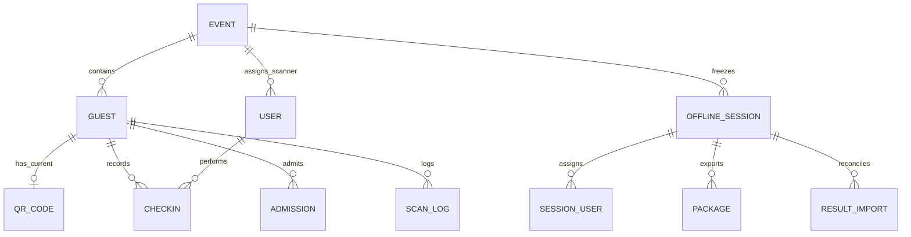
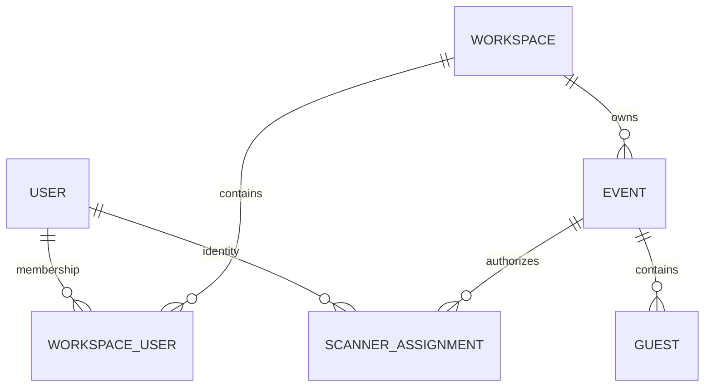

# Domain model

Audit date: 2026-10-11. **CURRENT** reflects [models](../app/Models) and [migrations](../database/migrations); live data/schema were not verified.

## CURRENT — event-scoped admission application

Diagram edges describe domain relationships; not every event edge has a database foreign key. Nullable audit links allow actors/guests to disappear without deleting every log.

| Entity | Meaning and ownership |
|---|---|
| `Workspace` | P3-002 prepared name/id/timestamps and event/member relations; no automatic owner or customer access |
| `workspace_users` | Required owner/manager role, inactive default, restrictive parent links and unique workspace/user; membership is separate from global role/scanner assignment |
| `User` | Shared email-or-phone/password identity; nullable unique canonical account phone, active flag and stored sw/en language; one legacy global role and protected dormant is_platform_admin flag default false. Scanner event/gate remain separate from workspace memberships |
| `Event` | Name, couple names, venue, date and active/archived/cancelled status and P3-002 nullable workspace_id; existing ownership remains unassigned |
| `Guest` | Event pass holder/family, canonical phone, four-digit manual code, type, allowance, used count and status |
| `QrCode` | One current guest QR row, globally unique token, image path and activation/revocation timestamps; event derives from guest |
| `Admission` | Successful quantity/admission details; separate from the more general scanner audit records |
| `Checkin` | Scanner outcome with optional user, guest and QR; event, gate, added/used/remaining counts and timestamp |
| `ScanLog` | Verification/admission diagnostic outcome, token hash and metadata; guest may be absent |
| `NotificationLog` | Delivery context/status with nullable guest/event links; an eventless record is not a workspace-owned record today |
| Offline family | Sessions, session users, encrypted-package metadata, guest snapshots, results imports, devices, imported logs, final guest states, conflicts and session audits |

Evidence: [User](../app/Models/User.php), [Event](../app/Models/Event.php), [Guest](../app/Models/Guest.php), [core migration](../database/migrations/2026_05_14_110000_create_core_qr_admission_tables.php), [offline schema](../database/migrations/2026_07_23_140001_create_offline_scanner_support_tables.php). Offline session users are package/session assignments, not workspace memberships or a general scanner-team table.

## CURRENT — invariants and qualifications

Single passes allow one, double two, special/family three through one hundred (3–100; updated 2026-11-12). Guest saving normalizes pass allowance/status and clamps usage to the allowance; direct SQL bypasses these model hooks. Four-digit codes are event-unique and string-valued. Admission controllers/services use transactions and locks, but a real two-connection MySQL race test remains necessary.

Guest/event relationships and copies of event IDs in logs need consistency checks. QR tokens must stay tied to the same guest through future workspace migration. Existing numeric IDs and external offline UUIDs are distinct contracts. See [DATABASE_CONVENTIONS.md](DATABASE_CONVENTIONS.md).

## IMPLEMENTED — P3-002 boundary

Workspace storage/relations are prepared and tested; no legitimate event owner, active membership or platform grant is inferred. Actual database rollout and tenant/platform authority enforcement remain open. [Evidence](PHASE_03_REPORT.md).

## TARGET — user-mandated SaaS domain

One user can join several workspaces; one workspace can own several events. Workspace Owner/Manager privileges and event scanner assignments remain separate. Platform administration is a separate authority over the platform.

Invitation template/version/design/asset/export entities are future structures; reuse any existing representation discovered before creating tables. Plans/subscriptions/entitlements/usage records follow stable tenant authorization and self-service. Pledge/payment/meeting/digital-card notification hooks do not establish implemented business modules.

### PLANNED — RSVP and personal invitation extension (2026-10-25)

One existing Event/Guest pair may have one current RSVP response plus response history and revocable invitation access capabilities. Event ownership is inherited through the existing Event → Workspace relationship; every duplicated parent reference must agree. The capability resolves an exact guest/design/event and is distinct from the existing admission QR. There is no second guest or pass model. Delivery attempts reuse NotificationLog with scoped batch/recipient provenance where required; an RSVP response is never a delivery status or admission counter.

Names/category/date-time/venue for the minimal setup must persist to the real Event, with explicit additive timezone/time mapping that preserves existing date-only records. Optional table assignment belongs to the existing guest association. Responses record intention; Guest.used_entries and admission history record actual entry. Default unanswered/declined responses do not invalidate existing QR passes. See [proposed schema, constraints and count semantics](RSVP_AND_GUEST_TICKETS.md) and [phase dependencies](phases/CUSTOMER_EXPERIENCE_INTEGRATION.md); none of these additions is implemented by this documentation update.

## PLANNED — migration acceptance

Preserve users, events, guests, tokens, codes, admissions, reports and scanner assignment provenance. Reconcile each existing record to a reviewed Legacy Workspace mapping. Resolve orphan event links and actor history before enforcing new constraints. Assign ownership without equating a user with a wedding and without granting all legacy admins customer ownership automatically.

## REQUIRES VERIFICATION — unresolved detail

Live cardinalities/duplicates, existing owner intent, notification ownership when event is null, deletion/retention policy and the exact future invitation/billing schemas remain unverified. This document establishes domain boundaries, not permission to create all potential tables.

## IMPLEMENTED — P3-004 source/test update (2026-10-18)

P3-004 adds private migration metadata for exact proposal identity and group-reference-to-workspace resolution. It is not customer ownership or permission evidence and creates no records automatically. No Eloquent hooks or user-facing ledger workflow exists. [Storage/protocol](OWNERSHIP_LEDGER.md).

## IMPLEMENTED — P3-022 creation provenance

The dormant workspace_provisionings ledger binds a creator and replay-key hash to one newly created workspace, retaining the original normalized-name hash. It has restrictive user/workspace links and unique creator/request and workspace keys. Creator provenance is not transferable current ownership or an authorization token; current active owner membership is checked on retry. New setup deliberately creates an active initial owner while legacy backfill remains inactive. No account, event or prior ownership is changed. [Contract](WORKSPACE_PROVISIONING.md).
