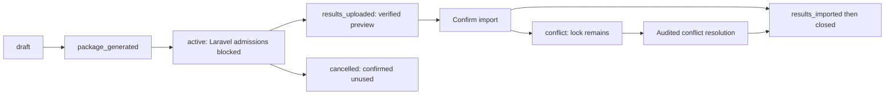

# Offline package and results reconciliation

P4-038 implements the P4-037 later-write design through three independent one-attempt stages and actual persisted receipts/full audit verification. Provider failures have no direct fallback, outer transaction or repeated unlink. Normal SQL-refusal partial effects and newly protected callback rollback windows remain distinct. Full gate: **2,028 tests / 41,407 assertions**. [Contract and limits](OFFLINE_SECURE_DELETE_BOUNDARIES.md).

Historical P4-037 design checkpoint (2026-10-29): P4-037 completes a later-write design only. Separate planned metadata/audit providers revalidate current authority using immutable asset context and the actual persisted metadata marker, without repeated unlink or a whole-operation transaction. Later authority remains unimplemented; P4-036 retains1,937/37,724 by preservation. [Protocol and limits](OFFLINE_SECURE_DELETE_BOUNDARIES.md).

Historical P4-036 byte-only checkpoint (2026-10-29): P4-036 implements the bounded secure-delete byte-phase authority fence reviewed in P4-035. The one-attempt provider and direct helper branches are exclusive; current context and captured disk pass to existing later writes without another unlink. Metadata/audit authority and irreversible-file recovery remain separate. Full source gate: **1,937 tests / 37,724 assertions**. [Implemented contract](OFFLINE_SECURE_DELETE_BOUNDARIES.md).

P4-034 implements bounded known root callback retry cleanup after the P4-032 observations and P4-033 design review. Actual retry entry, immutable marked artifacts, fresh authority and any-path reference vetoes gate deletion. Full source gate: **1,901 tests / 36,878 assertions**. General file/commit recovery remains open. [Recovery contract](OFFLINE_RETRY_ARTIFACT_RECOVERY.md).

Audit: 2026-10-11, Phase 0/1. **CURRENT** describes Laravel source, **TARGET/PLANNED** future work, and **REQUIRES VERIFICATION** missing operational evidence. See [scanner architecture](SCANNER_ARCHITECTURE.md), [device authentication](DEVICE_AND_OFFLINE_AUTH.md), and [Android status](ANDROID_SCANNER.md).

## Current lifecycle and authority

### HISTORICAL IMPLEMENTATION — P4-036 secure-delete byte authority (2026-10-29)

P4-036 routes both existing destroy actions through LegacyOfflineSecureDeletion::delete with explicit selected Event and canonical original/current Artifact, Session, Import Event and actor identities captured before queries. It freezes exact raw path/disk and the resolved fallback disk before the composed-helper hook. Its trusted optional byte-context provider uses exactly one default-connection transaction attempt: primary selected unowned Event → current exact active administrator → captured Session → Artifact. SQL namespace predicates constrain unowned Event, Session Event and Artifact parent/Import Event before full model hydration; raw post-hydration identity/parent/path/disk checks remain. Undeleted state is checked before bytes.

The shared FileStorage deleteEncryptedArtifactBytes primitive preserves private path/disk, missing-file and false/throw behavior and intentionally rechecks the existing global retention enable flag at the byte point. The provider performs the byte phase and returns current resource/Session/actor/path/disk. Provider and direct branches are exclusive: no ordinary parent reload, fallback on provider error, disk recalculation or second unlink follows provider success. Without a provider, trusted direct helpers retain their existing composition and named outcomes, with the added shared byte-point retention recheck. No age, archive or lifecycle prerequisite is introduced.

Only the byte phase is fenced here. The existing metadata UPDATE → audit INSERT → final fresh() tails remain outside the new byte transaction and unchanged. Current authority for those later writes is not implemented by P4-036. Under normal HTTP autocommit, metadata refusal still loses bytes without metadata/audit, and audit refusal still loses bytes while retaining committed metadata. An enclosing caller transaction still changes SQL commit/rollback scope; unlink remains irreversible. Both destroy actions now pass late HttpExceptionInterface403/404 through before their RuntimeException catch; success/validation behavior and generic storage/SQL feedback remain. No retry around unlink is added.

The independent LegacyOfflineSecureDeletionBytesTest passes **36 cases / 846 assertions**. Existing deletion compatibility passes **17/353** with all prior failure-outcome fields and assertions intact; import workflow **11/189**, focused **836/16,380** and full **1,937 tests / 37,724 assertions** pass with zero errors, failures or skips. All86 prior classes retain exact case/assertion counts.

The original-source HTTP-only run reproduced **30 failures / 156 assertions / zero errors in30 cases**. Four direct future-service identity cases and two direct-helper controls were excluded from that original-source filter. Some failures are newly required context/transaction observations, not30 distinct vulnerability claims. The fixed matrix checks both artifacts for late ownership/actor/Session/Artifact/path/disk/deleted-state/retention changes, no byte access on refusal, current provider context, ordinary/platform/member administrators, historical archived/revoked packages and failed results, missing file/path, frozen fallback disk, no double unlink, malformed direct service context and one-attempt concurrency-shaped storage failure.

Five scoped PHP syntax/read-only Pint checks and unchanged100-route/32-table safe CLI pass. Token-normalized comparison preserves28 existing methods, permits four existing method changes and adds the shared deleteEncryptedArtifactBytes primitive; the metadata/audit/fresh tails are identical. One scoped tenancy service and one independent test class are added. All361 unrelated non-document baseline paths and356 frozen tested-source paths match, including environment/app key, Git index and existing builds. No configured retention flag/configuration, migration/schema, route, grant, admission algorithm, actual data/account/ownership/service, dependency/build or deployment was changed.

R33 is partly mitigated only for current authority at the named secure-delete byte phase. Later metadata/audit current authority and the inherited final fresh() graph remain separate. Shared-path ownership/provenance, path aliases, historical encrypted-content attribution, arbitrary external writers, partial adapter effects, byte-phase commit uncertainty, caller-owned transactions, forensic erasure and durable file/SQL recovery remain open. A false/throwing adapter may already have changed bytes; the injected storage faults retain bytes by construction and establish no general undo guarantee. The single attempt prevents framework retry around unlink but cannot restore a file or prove an uncertain commit outcome. SQLite observations establish the named transaction/builder intent and conservation cases, not actual MySQL row-lock waits or durable storage. R32's remaining preview commit/crash/reconciliation limits also stay open. Invitation/RSVP and the common simple UI remain planned; Phase4 and actual rollout gates remain IN PROGRESS.

### IMPLEMENTED — P4-034 bounded retry artifact cleanup (2026-10-29)

P4-034 implements bounded cleanup for artifacts from a failed root transaction callback only after this invocation actually enters a later retry. Each callback resets its current cleanup path/disk before guards; immutable marked attempts retain their path, disk and actual PDO. Registration occurs only in the callback catch with root entry, level1, same-PDO and an open physical transaction. The rollback callback only marks local state. A later callback rechecks the current Event → active administrator → Session prefix and root/PDO identity before cleanup.

Before touching a prior file, a current primary locking ID-only Import lookup vetoes ANY matching encrypted_file_path, without Event or disk filtering or foreign private Import hydration. The captured disk selects the file. A missing file is tolerated; false/throwing deletion stops before another put. Storage exceptions are wrapped with a fixed nonconcurrency message so Laravel cannot silently retry them as database contention. No outer transaction, global listener, artifact scan or retention/quarantine policy is added.

The independent OfflinePreviewRetryArtifactCleanupTest passes **17 cases / 783 assertions** at actual SQLite :memory: autocommit0 with fake private files. Existing workflow **11/189**, focused **800/15,534** and full **1,901 tests / 36,878 assertions** pass with zero errors, failures or skips. All85 prior classes preserve exact case/assertion counts. The original-source16-case run reproduced14 failures /324 assertions /zero errors, with two compatibility controls passing. These are regression outcomes, not14 distinct vulnerability claims.

The initial16-case candidate passed16/749. A subsequent transient storage deletion exception containing a concurrency-shaped message reproduced one failure /3 assertions /zero errors; the fixed-message storage wrapper then made the final17-case matrix pass. The storage error now stops before another put even when its original message resembles a database retry. These controlled exceptions and explicit PDO commits are not real contention or lost-acknowledgment simulations.

Scoped PHP syntax/read-only Pint and unchanged100-route/32-table safe CLI pass. Token-normalized comparison preserves19 existing methods and permits only storePreview plus one private cleanupRolledBackPreviewArtifact helper; the current Event/active administrator/Session prefix and Guest/child/status processing remain intact. All362 unrelated non-document baseline paths and354 frozen tested-source paths match, including environment/app key, Git index and existing builds. No migration, route, grant, admission algorithm, configured data/account/ownership/service, dependency/build or deployment change.

This repair partly mitigates R32 for known root callback rollback/retry only. Current authority loss leaves earlier files untouched; unsuccessful cleanup leaves the artifact outcome unresolved for separate reconciliation. The injected false/throwing deletion fixtures fail before unlink and retain bytes by construction. An adapter may act before returning false or throwing; no general byte-retention or undo guarantee follows. A successful callback followed by a commit-class error leaves its earlier artifact unmarked across later callback entry, even when that artifact has no database reference. The inherited final catch still acts on its current attempt and captured disk; same-attempt final/uncertain commit outcomes are not certified safe. Process crashes, lost acknowledgment, durable cleanup-failure reconciliation, enclosing caller rollback, arbitrary external transaction/file/reference manipulation and secure-delete recovery remain open. R33, child recertification and historical/internal return graphs remain separate. SQLite query instrumentation establishes primary/locking/ID-only builder intent, not actual MySQL row-lock behavior; lookup breadth/indexing and engine schedules remain rollout/performance review work. The NULL-disk reference is a synthetic SQLite-only malformed/legacy-schema fixture, not the installed schema. Invitation/RSVP and the common simple UI remain planned; Phase4 remains IN PROGRESS.

### HISTORICAL OBSERVATION — P4-032 deterministic retry files (2026-10-28)

P4-032 confirms a deterministic callback-rollback/retry artifact gap in the unchanged preview source. At actual transaction level0 on SQLite :memory: with fake private storage, a child INSERT trigger fails after a successful file put. A synthetic `database is locked` message is recognized by the installed Laravel concurrency detector and retries the callback after SQL rollback. Success on retry2 leaves one earlier unreferenced attempt file beside the committed file; three failed attempts leave two earlier unreferenced files after only the final path is cleaned. An ordinary nonconcurrency refusal takes one attempt and leaves no attempt artifact.

External TEMP probe: **3 cases / 269 assertions**; unchanged P4-031 regular-suite gate **1,884 tests / 36,095 assertions** retained by all353 source fingerprints. No application/test or cleanup-policy change. The injected message exercises Laravel retry classification rather than real lock contention; uncertain commit, cleanup failure and deletion recovery remain unverified. [Outcome table](OFFLINE_UPLOAD_FILE_EFFECTS.md).

### IMPLEMENTED — P4-031 preview storage authority (2026-10-28)

storePreview now captures canonical original/current Session PK/Event and actor identities, explicit selected Event and validated envelope Event equality before its transaction. Captured IDs remain fixed across its existing three attempts. Inside that same transaction and cleanup catch, primary locks run Event → current active exact administrator → Session; the Event must remain unowned and the Session must retain the captured Event. Platform and workspace-linked administrators retain existing eligibility. Package/session-user relations load only after these head checks, and all preview references/audits use the current locked actor and Session.

The existing malformed locked Session Event validation remains; canonical reparent/ownership mismatch is404 and lost administrator eligibility403. No preview records, file put or new preview audit occurs on these refusals; prior authorized preliminary audit traces remain. The existing internal duplicate/lifecycle/package refusals and three-attempt transaction/cleanup boundary are preserved. Full **1,884 tests / 36,095 assertions**, boundary **13/363**, focused **783/14,751**, workflow **11/189**; all84 prior classes retain counts/assertions. [Detailed probes and remaining boundaries](OFFLINE_UPLOAD_FILE_EFFECTS.md).

### IMPLEMENTED — P4-030 preliminary upload audits (2026-10-28)

LegacyOfflineUploadAudits validates canonical original/current Session/Event and actor identities plus explicit selected Event before queries. Each external Uploaded, VerificationFailed or Reimport audit uses its own default-connection transaction with primary Event → current active exact administrator → Session locks. The Event must remain unowned and the Session must retain the captured Event. Platform and workspace-linked administrators retain existing eligibility and the generic audit format is unchanged.

verifyUpload now receives selected Event from the existing controller and uses the guarded current Session/actor instead of default-read fresh() substitution. Failed validation and the external duplicate attempt recheck authority before their audit insert. Late ownership/parent mismatch 404 and administrator eligibility 403 pass through the preview controller's broad catch. Authorized invalid files retain normal validation feedback and legitimate audit traces. No outer upload/preview transaction was added: under normal HTTP autocommit, preliminary audits persist independently of preview success. An existing caller transaction may still enclose them; these are not autonomous commits.

Full 1,871 tests / 35,732 assertions; boundary 16/282, focused 770/14,388 and existing workflow 11/189. All 83 prior classes preserve counts/assertions. The 11-case original-source HTTP run reproduced seven failures/189 assertions/zero errors. Preview storage and its internal duplicate audit are unchanged. [Evidence and remaining work](OFFLINE_UPLOAD_FILE_EFFECTS.md).

### AUDITED — P4-029 upload/file effects (2026-10-28)

The historical P4-029 source audit recorded the then-current boundaries and safe next scopes in the [upload/file audit](OFFLINE_UPLOAD_FILE_EFFECTS.md). It changed no runtime behavior. The P4-030 section above records the later external-audit implementation; preview/file recovery and secure deletion remain separate.

### IMPLEMENTED — P4-028 sibling write integrity (2026-10-28)

Resolver actions that update siblings now select only identity/status columns of the current OPEN sibling set on primary, lock in ascending PK order, validate canonical raw Event/Import/Log links and exact OPEN status, then freeze those IDs before Guest/action effects. The query deliberately has no Event prefilter: a preexisting inconsistent child rejects the whole operation rather than being silently ignored or repaired. The later bulk update targets only frozen IDs and repeats Event/Import/Log/open predicates. Literal-null Log and escalation paths skip siblings, retaining their existing behavior; resolved history and unrelated Import/Log records remain outside this write set. Newly inserted or changed rows stay OPEN, and authoritative readiness checks keep the Import/Session pending.

Full **1,855 tests / 35,450 assertions** (JUnit aggregate 210.158937s), focused **754 / 14,106** (155.969319s), boundary **10 / 390** (4.334873s), existing import workflow **11 / 189** (11.409641s), zero errors/failures/skips. All82 prior classes retain exact counts/assertions.

The original10-case run reproduced five failures /233 assertions /zero errors; five compatibility controls passed. New coverage includes owned/unowned bad OPEN siblings refusing before Guest/QR hydration or DML, valid/MAX siblings, resolved/unrelated history, null Log, escalation, controlled own/foreign post-freeze insertions and a controlled validated-row Event change. Full-table/private-file snapshots verify complete refusal for preexisting damage and exact authorized target effects for later insert/change hooks. Those same-connection hooks do not establish real MySQL races, phantom prevention or arbitrary external-writer fencing.

Two PHP syntax/read-only scoped Pint checks and unchanged100-route/32-table safe CLI pass. Token-normalized comparison preserves15 existing methods; only resolve and resolveSiblingConflicts change, with one private lockedSiblingIds helper added. All358 unrelated non-doc baseline paths and350 frozen source fingerprints match, including environment/app key, Git index and existing builds. The prior authority, Log and Guest/QR processing checks remain intact.

Ascending sibling order does not prove direct internal calls deadlock-free: existing target Conflict/Import acquisition can already form cycles. Normal same-Event HTTP writes serialize through the Event wrapper; actual engine schedules remain separate. Upload preliminary audits and preview/file commit recovery, secure-delete partial effects, atomic QR mutation/recertification and historical actor/internal return graphs remain open. No schema, route, permission architecture, admission algorithm, configured data/account/ownership/service, dependency/build or deployment changed. New invitation/RSVP and all-interface design rollout remain planned. [Task evidence](PROJECT_PLAN.md).

### IMPLEMENTED — P4-027 resolver Guest processing (2026-10-27)

Resolver bound-Guest and replacement lookups now use canonical raw/input IDs and the validated raw Event. A shared lockedGuestInEvent helper retains the Guest lock phase through an ID-only primary existence read, preserving missing-record exception and wrong-Event validation behavior without loading foreign Guest details. Current Guest models are queried only in that Event and their raw PK/Event are rechecked before the existing QR relation is loaded on primary. Both action paths use this helper; there is no new pass, token or admission algorithm. Existing Single/Double/Family capacity, history, manual-count and literal-null rules remain intact.

Full **1,845 tests / 35,060 assertions** (JUnit aggregate 327.250514s), focused **744 / 13,716** (136.497106s), boundary **15 / 231** (4.401653s), existing import workflow **11 / 189** (11.135806s), zero errors/failures/skips. All81 prior classes retain exact counts/assertions.

The corrected old-source15-case run reproduced nine failures /220 assertions /zero errors, with six compatibility controls passing. Two earlier fixture runs are retained separately: GuestFactory does not exist, and the Family control initially expected closure while other conflicts remained open. The corrected fixture uses the existing Guest model and preserves pending Import/Session state for unrelated open conflicts. These corrections changed no production policy or prior tests. New cases cover late owned/unowned bound/replacement movement, no foreign Guest/QR hydration, unsafe aliases beside MAX, valid MAX Double/Family admission, manual zero, full Single refusal, null Guest behavior and raw Guest Event validation before QR. Complete row/private-file snapshots verify denial and exact target/history changes.

Two PHP syntax/read-only scoped Pint checks and unchanged100-route/32-table safe CLI pass. Token-normalized comparison preserves14 existing methods, including Log validation and admission application; two Guest lookup methods change and one private lockedGuestInEvent helper is added. All357 unrelated non-doc baseline paths and349 frozen source fingerprints match, including environment/app key, Git index and existing builds.

P4-025 current HTTP authority and P4-026 Log processing checks remain intact. Sibling bulk-update integrity, atomic QR mutation/recertification, historical actor/internal return graphs, upload preliminary audits and secure-delete/file/commit recovery remain separate gates. Controlled SQLite/hydration evidence does not establish malformed live-schema or MySQL contention behavior. No schema, route, permission architecture, admission algorithm, configured data/account/ownership/service, dependency/build or deployment changed. New invitation/RSVP and all-interface design rollout remain planned. [Task evidence](PROJECT_PLAN.md).

### IMPLEMENTED — P4-026 resolver bound-Log processing (2026-10-27)

The existing OfflineScannerImportConflictResolver now parses canonical raw caller Conflict identity before its transaction, removes blind initial Log/parent eager loads and validates current locked raw Conflict/Import/Session/Event context before subsequent numeric lookups. It retains Conflict → Import → Session → Log lock phases and the existing transaction/retry count. A literal null bound-Log FK preserves existing no-Log actions; every non-null key must be canonical and resolve to a primary locked Log in the same Import and Session, with raw IDs rechecked after hydration. Unsafe/missing/foreign/mismatched Logs fail through generic conflict_resolution validation before effects. Explicit safe/null importedLog and parent relations ensure manual adjustment uses the validated locked Log.

Full **1,830 tests / 34,829 assertions** (JUnit aggregate 525.41716s), focused **729 / 13,485** (61.496304s), boundary **19 / 324** (3.444358s), existing import workflow **11 / 189** (4.315815s), zero errors/failures/skips. All80 prior classes retain exact counts/assertions.

The original19-case run reproduced12 failures /249 assertions /zero errors, with seven compatibility controls passing. New cases cover late owned/unowned/same-Event-other-Import/Session-mismatch Log swaps, literal-null actions, safe manual adjustment, malicious preloaded relations, controlled unsafe Log/caller aliases beside real MAX records, canonical MAX controls and direct current-parent mismatches. Full-table/private-file conservation exposes old unintended writes and verifies fixed refusals; normal foreign Log hydration is observed independently. Controlled hydration is not a malformed live schema or MySQL contention rehearsal.

Two PHP syntax/read-only scoped Pint checks and unchanged100-route/32-table safe CLI pass. Token-normalized comparison preserves14 existing methods, including every action/admission method; only resolve changes and one private lockedLogForConflict helper is added. Pint normalizes existing whitespace in the touched class. All356 unrelated non-doc baseline paths and348 frozen source fingerprints match, including environment/app key, Git index and existing builds.

HTTP ownership/administrator permission remains the P4-025 wrapper; structural checks inside direct resolution do not grant new authority. Guest/replacement global reads and integer Event comparisons, sibling bulk-update integrity, historical actor/internal return graphs, upload preliminary audits, scanner recertification and secure-delete/file/commit recovery remain separate gates. No admission algorithm, schema, route, permission architecture, configured data/account/ownership/service, dependency/build or deployment changed. New invitation/RSVP and all-interface design rollout remain planned. [Task evidence](PROJECT_PLAN.md).

### IMPLEMENTED — P4-025 locked HTTP conflict resolution (2026-10-27)

LegacyOfflineConflictResolution validates canonical raw original/current Conflict, Import/Event references, selected Event and actor identity before queries. It captures only primary Import identity metadata to choose a canonical Session, then freezes that parent across retries. Its outer default-connection transaction locks Event → current User → Session → Import → Conflict, requiring the captured unowned Event, exact active administrator and all captured parent links. Platform and workspace-linked administrators retain existing eligibility. The unchanged resolver runs on the same connection with its existing lifecycle/action/admission rules. Late head/ownership and actor changes pass through as generic404/403; resolved-conflict HTTP403 remains unchanged.

Full **1,811 tests / 34,505 assertions** (JUnit aggregate 196.443158s), focused **710 / 13,161** (62.27619s), boundary **23 / 364** (7.064692s), existing feedback compatibility **10 / 277** (2.039807s), zero errors/failures/skips. All 79 prior classes retain exact test/assertion counts.

The original HTTP-only run reproduced eight failures / 186 assertions / zero errors in12 cases; four successful-resolution/rollback controls passed. Wrapper-only cases were not run against missing source. The23 fixed cases cover late ownership/actor/coherent-parent/Conflict-parent changes, ordinary/platform/member-admin keep/reject actions, actual partial-write audit rollback, ordered identity/lock observations, raw context rejection before queries and failed Import capture. The missing-capture case uses a controlled cloned caller with an absent canonical Import ID; it does not create a dangling live schema or disable constraints. Whole-row/private-file conservation protects denials, successful target-only changes and rollback.

Four PHP syntax/read-only scoped Pint checks, unchanged100 route method/path pairs and32-table safe CLI pass. Token-normalized comparison preserves22 unrelated methods and permits only one controller method plus one fixture expectation. The existing SQL-feedback fixture now expects nested level3 for both HTTP actions at the same assertion; every prior case, rollback/sanitization check and assertion count remains intact. All353 unrelated non-doc baseline paths and347 frozen source fingerprints match, including environment/app key, Git index and existing builds.

This is current HTTP administrator/head protection, not complete resolver isolation or actual MySQL contention/retry proof. Bound-log, Guest/replacement and sibling effects, historical actor/internal eager graphs, upload preliminary audits, scanner recertification and secure-delete/file/commit recovery remain separate gates. The original resolver/admission algorithms and direct internal callers are unchanged. No schema, configured data/account/ownership/service, dependency/build or deployment changed. New invitation/RSVP and all-interface design rollout remain planned. [Task evidence](PROJECT_PLAN.md).

### IMPLEMENTED — P4-024 locked HTTP confirmation (2026-10-27)

LegacyOfflineResultConfirmation now checks canonical raw original/current Import, Session/Event references, selected Event and actor identity before database work. Its outer default-connection transaction locks primary Event → current User → Session → Import. The captured Event must remain unowned; the actor must remain an exact administrator with known true activity; all captured parents must still match. Platform and workspace-linked administrators retain existing legacy eligibility. The unchanged importer runs on the same connection with its existing reconciliation, lifecycle/capacity/history checks and completed internal no-op. The completed HTTP request still returns its existing403; late ownership/parent and actor refusals pass through as generic404/403.

Full **1,788 tests / 34,141 assertions** (JUnit aggregate 166.151363s), focused **687 / 12,797** (60.134706s), new boundary **24 / 389** (4.022976s), existing confirmation compatibility **12 / 488** (3.497054s), zero errors/failures/skips. All 78 prior classes retain exact counts/assertions.

The original HTTP-only run reproduced seven failures / 203 assertions / zero errors in 11 cases; four compatibility/rollback controls passed. Wrapper-only cases were not run against missing source. The new 24 cases cover late ownership/actor/coherent-parent changes, ordinary/platform/member-admin imports, real partial-write rollback, guarded completed retry, prefix query ordering and twelve raw contexts rejected before queries/transactions. Whole-row/private-file snapshots conserve late refusals and rollback. The initial focused run had two failures caused by an old transaction-depth fixture expectation. Exactly two P4-021 hydration hooks now target importer level3, and the SQL-feedback fixture expects confirmation at3 while conflict resolution remains2. Every prior case, business expectation, rollback/sanitization assertion and assertion count is retained; token-normalized comparison limits these three fixture changes to their depth expressions. The initial failed artifacts remain separately recorded.

Five PHP syntax/read-only scoped Pint checks, unchanged 100 method/path pairs and 32-table safe CLI pass. Source comparison preserves 51 unrelated methods, permits one production method plus three fixture-only methods, and conserves 350 unrelated non-doc paths and 345 frozen source paths, including environment/app key, Git index and existing builds.

This is bounded HTTP confirmation protection, not complete tenant isolation or actual MySQL contention/retry proof. Conflict resolution, upload preliminary audits, nested/internal history and actor policy, scanner recertification and secure-delete/file/commit recovery remain separate gates. No schema, configured data/account/ownership/service, dependency/build or deployment changed. Planned UI/RSVP and all-interface usability work remain unimplemented. [Task evidence](PROJECT_PLAN.md).

### IMPLEMENTED — P4-023 current scanner HTTP review projections (2026-10-27)

LegacyOfflineScannerReview now handles current scanner relations on setup/create latest and active Session data, Session show, result show/logs/conflicts and conflict detail. It replaces blind scanner eager loads before retrieval and validates canonical raw Session/Import/Event and child lineage. Session master/assignments, devices, full imported logs, separate paginated logs and conflict-log instances are projected explicitly. A conflict's raw bound log identity must agree; invalid shared associations receive independent in-memory projections.

Current User models are queried on primary only in the validated Event, with byte-exact scanner role, known false platform flag and no workspace membership of any role/activity. Raw hydrated identity fields are checked again before mapping. Inactive ordinary same-Event scanners remain readable in history; new-generation active-only requirements are unchanged. Safe/null relations overwrite preloaded values. Canonical historical scanner FK/filter IDs and captured names/gates/device metadata remain intact when a current User is unavailable; only noncanonical unsafe scanner FKs are masked with clean dirty tracking. This differs deliberately from P4-022 unavailable current Guest FK masking.

Full **1,764 tests / 33,752 assertions** (JUnit aggregate 354.836494s), focused **663 / 12,408**, boundary **16 / 3,805**, zero errors/failures/skips; all 77 prior classes retain exact counts/assertions. The original 16-case run had 172 assertions / 16 failures / zero errors, including missing explicit-null projection controls, rather than 16 distinct vulnerabilities. Natural rename/reassignment reproduced foreign current User hydration; blank captured names in filtered review reproduced private HTML. The fixed cases cover protected identities, active/inactive local history, preloaded relations, controlled raw aliases beside MAX and selected child Session mismatches, with table/private-file conservation across all six GET graphs.

Five PHP syntax/read-only Pint checks, unchanged 100-route/32-table CLI, 343 frozen source paths and 348 unrelated non-doc paths pass; normalized comparison preserves 17 unrelated methods and permits six changes. Actor created/uploaded/resolved/audit policy, arbitrary historical metadata, optional filter-request coercion, internal returns, current authority/concurrency fences, resolver effects and file/commit recovery remain separate. This is current read projection, not whole-tenant privacy, atomic revocation or UI/RSVP implementation. No schema, writer, policy, configured data/service or deployment changed. [Task evidence](PROJECT_PLAN.md).

### IMPLEMENTED — P4-022 historical Guest HTTP review projections (2026-10-26)

Result show/logs/conflicts and conflict-detail reviews now use LegacyOfflineGuestReview after existing legacy head/permission checks. Blind Guest/replacement eager loads are removed. Canonical raw Import/Session/Event lineage and matching child IDs precede an Event-scoped primary Guest query. Current Guest/replacement/final-state relations are explicitly assigned, including null; unsafe/unavailable current FK attributes are masked in memory with clean dirty tracking. Preloaded relations are replaced before previewSummary can load missing relations.

Stored conflict server_state/server_used/server_remaining display requires canonical matching Event/Guest attribution and agreement with any non-null raw bound Guest FK. A physically null FK may retain correctly attributed own history after deletion. Valid own-Event history remains visible after Guest movement; exported snapshot/offline/expected state and resolution metadata remain intact. The projection never saves a redaction or repairs stored rows/private files. This is structural attribution, not cryptographic proof of arbitrary database JSON.

Full **1,748 tests / 29,947 assertions** (JUnit aggregate 548.530188s), focused **647 / 8,603**, boundary **16 / 1,409**, zero errors/failures/skips; all 76 prior classes retain exact counts/assertions. The initial 14-case original-source run reproduced ten failures / 420 assertions / zero errors; two child-lineage cases were added later. HTTP coverage includes foreign owned/unowned current relations and history, own history after move/deletion, null FK, preloaded relations, controlled raw aliases beside MAX, child Event mismatch and final-state Session mismatch. Every covered GET conserves whole-table rows/private-file hashes before projection assertions.

Four PHP syntax/read-only scoped Pint checks, unchanged 100-route/32-table CLI, 341 frozen source paths and 347 unrelated non-doc paths pass. P4-022 closes this named HTTP Guest review slice; internal freshImport/preview/resolver return graphs, scanner/actor references, broader nested history, arbitrary historical text, current authority/concurrency fences and file/commit recovery remain separate. No schema, route, writer/admission, policy, configured data/service, dependency or deployment changed. Planned UI/RSVP features remain unimplemented. [Task evidence](PROJECT_PLAN.md).

### IMPLEMENTED — P4-021 confirmation Guest references (2026-10-26)

Confirmation now validates canonical raw locked Session/Import Event IDs and equality before processing effects. External IDs and raw snapshot guest_id values reuse PositiveIntegerId before numeric lookup; the model's integer cast cannot turn an unsafe raw key into a real maximum-ID Guest. An ascending ID-only existence lock query retains the Guest lock phase, and current Guest/QR processing models are then limited to the validated Event. Transaction/retry count and later lock phases remain unchanged; actual MySQL scheduling remains a separate verification gate.

Every snapshot-to-current-Guest resolution in baseline checks, log application and final-state application uses the same raw-ID helper. Moved exported guests retain WRONG_EVENT while new conflict Guest/state/count bindings are null and historical exported snapshot context remains. A final state cannot mutate a foreign Guest merely because that Guest has no current-import log to mark it blocked.

The new two-preview case is important: an earlier pending Guest A log can contribute to the Session ledger while a later Guest B log with the same sequence is conflicted. The second authenticated file may contain a final state for A. The old importer applied that final count after A moved to another Event because its current-log loop only blocked B. The corrected processing model collection excludes foreign A. The test retains existing same-Event ledger behavior as a compatibility observation, not approval of the overall sequence-collision protocol.

The corrected pre-fix run reproduced nine failures / 218 assertions / zero errors; after the fix, the 12-case class passes 488 assertions, focused regression passes 631 tests / 7,194 assertions, and full regression passes **1,732 tests / 28,538 assertions** with zero errors/failures/skips. All 75 prior classes retain exact test/assertion counts. Ordinary and canonical MAX controls preserve successful confirmation, existing closed-session HTTP403 and the internal completed-import no-op. Raw snapshot/Event guard cases alter controlled model hydration, not a live schema. Whole-table/private-file snapshots protect neighbors and allow only target reconciliation effects. P4-021 is COMPLETE in source/tests; Phase 4 remains IN PROGRESS.

This protects reconciliation processing, newly written conflict state and count/admission effects. At the P4-021 gate, the existing freshImport return graph and HTTP review eager relations remained unchanged; P4-022 above subsequently protects the named HTTP Guest review slice without repairing old stored state. Internal return graphs, current actor/Event ownership fences, nested resource integrity, resolver actions, session-user recertification and file/commit recovery remain separate. No schema, configured data/service, account/ownership, dependency or deployment changed. See [execution plan](PROJECT_PLAN.md).

### IMPLEMENTED — P4-020 preview Guest references (2026-10-26)

The preview service now validates the locked Session's raw Event ID with the shared PositiveIntegerId parser before creating preview rows or a private results file. The parser accepts positive integers and canonical decimal strings through PHP_INT_MAX; it rejects zero, padding, signs, floats/bools, newline suffixes and overflow before integer conversion. Existing preliminary upload audits remain outside this guard; it is not a claim that every rejected upload has no effects.

Current Guest models and QR relations are loaded only for the locked Session Event. Raw external IDs are deduplicated strictly before safe numeric parsing, so an ambiguous numeric string cannot discard a legitimate maximum-ID value. A separate ID-only existence query is restricted to identities found in this Session's exported snapshots. It preserves WRONG_EVENT classification for a moved exported guest without passing a foreign Guest model, current name/pass state or current Guest FK into new conflict/final-state records. Historical exported snapshot context is retained. Same-Event missing-snapshot context remains compatible.

Review log lookup and numeric Guest search use the same parser. The log table uses the raw external key instead of casting it, preventing an overflow/newline row from borrowing a legitimate canonical MAX Guest loaded on the same page. Name/manual-code text search remains available; the numeric fallback uses a supported bound ID predicate.

Boundary checks pass **36 tests / 866 assertions**, related scanner/offline checks pass **619 tests / 6,706 assertions**, and full regression passes **1,720 tests / 28,050 assertions** with zero errors/failures/skips. All 74 prior classes retain exact counts/assertions. The new class includes nine authenticated encrypted-upload/review cases, 24 parser inputs and three controlled locked-model hydration cases. They check current foreign-state redaction, canonical MAX compatibility, mixed-row display/search, whole-table/private-file conservation and refusal before preview effects. The locked-model cases deliberately change only the hydrated raw value inside the existing preview transaction; they are not malformed live-schema or MySQL concurrency evidence. The retained pre-fix run has eight failures / 369 assertions / zero errors, including the numeric-search HTTP failure. P4-020 is COMPLETE in source/tests; Phase 4 remains IN PROGRESS.

Limits: this is a bounded preview namespace/ID fix. It does not repair old stored leaks, fence concurrent Guest movement/current actor authority, change confirmation/resolver Guest handling, recertify scanner/session-user keys or improve file/commit recovery. Transaction/retry/lock order, crypto, audit/file order, schema and scanner protocols are preserved. No configured database, account, ownership or deployment change occurred. See [task contract](PROJECT_PLAN.md).

An administrator chooses event-authorized master/client scanner users and gates, supplies a strong confirmed package password (≥16 characters including uppercase/lowercase/digit/symbol), a future expiry, and confirmation. Package generation locks the event, validates a guest snapshot, stores the encrypted file and baseline rows, then transitions `draft → package_generated → active` inside a transaction. Generation failures clean up the file and roll back database writes. [Request validation](../app/Http/Controllers/Admin/Concerns/HandlesOfflineScannerAdmin.php), [builder](../app/Services/OfflineScannerPackageBuilder.php).

`package_generated`, `active`, `awaiting_results`, `results_uploaded`, and `conflict` block web admission and admission-sensitive changes. `results_imported`, `closed`, `cancelled`, `expired` and `draft` do not. A generated `active_event_id` unique index enforces one blocking session/event; service code also locks the event row. Cancellation requires an admin, confirmation that Android was unused and a reason, and rejects sessions with applied results. Successful conflict-free import closes/unlocks the session; unresolved conflicts keep it locked. [Session model](../app/Models/OfflineScannerSession.php), [lock service](../app/Services/OfflineEventLockService.php), [session migration](../database/migrations/2026_07_23_140000_create_offline_scanner_sessions_table.php).

**CURRENT RISK:** [SessionService::transition](../app/Services/OfflineScannerSessionService.php) validates the destination name and uniqueness, not an allowed transition graph. Caller restrictions currently carry lifecycle safety. Do not use a direct transition to release a lock or treat `expired` as proof no offline admissions remain. Automatic expiry processing was not established by this audit.

## Current `.wqrpkg` contract

The extension contains canonical JSON, not ZIP. Envelope format is `harusi.offline-scanner.package`, schema `1.0`, with `package_export_id`, `session_uuid`, encryption/KDF metadata, base64 salt/IV/ciphertext/tag and signature metadata. AES-256-GCM uses a random 12-byte IV, 16-byte tag and a 32-byte PBKDF2-HMAC-SHA256 password key; default iterations 210,000, salt 32 bytes. Ed25519 signs canonical envelope bytes before the signature fields are appended. HMAC-SHA256 is an explicitly configured fallback, disabled by default. Verify trust using pre-established keys; a supplied key ID alone does not establish trust. [Package crypto](../app/Services/OfflineScannerPackageCryptoService.php), [signature service](../app/Services/PackageSignatureService.php), [configuration](../config/services.php).

Decrypted top-level fields: `schema_version`, `package_export_id`, `session`, `event`, `scanner_users`, `guests`, `security`, `snapshot`. Session metadata carries expiry, snapshot version, protocol version and minimum Android version (defaults `1.0` and `1.0.0`). Guest rows contain string `external_guest_id`, event, display name, normalized phone, 4-digit manual code, pass type, allowed/used/remaining entries, status, `admission_disabled`, canonical QR SHA-256, timestamps and `record_version`. Raw QR tokens are excluded. Snapshot and record versions are SHA-256 of canonical data. [Snapshot service](../app/Services/GuestSnapshotService.php), [validator](../app/Services/OfflineScannerPackageValidator.php).

[CanonicalJson](../app/Services/CanonicalJson.php) recursively sorts object keys lexicographically, preserves array order, and encodes unescaped Unicode/slashes with preserved zero fractions. Cross-language byte compatibility needs test vectors, especially number and timestamp serialization; do not replace this algorithm implicitly.

## Current `.wqrresults` contract

This is the authoritative master result **file import** contract, not a live sync API. The [schema](../app/Services/OfflineScannerResults/OfflineScannerResultSchema.php) defines format `harusi.offline-scanner.results`, version `1.0`. Safe filename and `.wqrresults` extension are required; maximum upload is 20 MiB.

Envelope requires exactly: `format`, `result_schema_version`, `source_package_export_id`, `session_uuid`, `results_export_id`, `event_id`, `master_device_id`, `encryption_algorithm`, `initialization_vector`, `encrypted_payload`, `authentication_tag`, `payload_hash`. IDs for package/session/export are UUIDs; event is a positive integer; device ID is a nonempty string ≤191; hash is lowercase SHA-256; algorithm is `AES-256-GCM`; IV/tag decode to 12/16 bytes.

AES-GCM uses the exported 32-byte result encryption secret. Additional authenticated data is canonical JSON of event, format, master ID, payload hash, schema, result export ID, session UUID and source package export ID. Payload hash is SHA-256 of canonical decrypted JSON. There is no separate Ed25519 signature field in this results format. [Envelope binding](../app/Services/OfflineScannerResults/ResultsEnvelope.php), [result crypto](../app/Services/OfflineScannerResults/OfflineScannerResultsCryptoService.php).

| Payload object/list | Required content |
|---|---|
| `session` | Session/package/export/event/master IDs, `session_started_at`, `session_closed_at`, `final_master_sequence_number`, `exported_at` |
| `devices[]` | ID/name, role `master` or `client`, scanner ID/name, gate, paired/last-seen timestamps, admission count; exactly one matching master |
| `admission_logs[]` | `log_uuid`, `request_uuid`, master sequence, external guest ID, scanner/device/gate, method, nullable QR hash, added entries, before/after used/remaining, result code, device/master timestamps, device monotonic sequence, base guest record version |
| `final_guest_states[]` | External guest ID, final used/remaining, final record version, last master sequence |
| `metrics` | Total scans, admitted people, invalid scans, manual admissions, QR admissions; must reconcile with logs |

Methods are `qr`, `manual`, `phone`. Result codes are `admitted_successfully`, `valid_pass`, `already_fully_used`, `invalid_qr`, `wrong_event`, `disabled_pass`, `insufficient_remaining`, `duplicate_request`, `rejected`, `cancelled`. Successful logs add positive entries; other outcomes add zero. Submitted sequences must form the ordered complete master stream `1..N`; final sequence equals log count. This contract is not an incremental unordered delta upload. Detailed types and additional consistency rules remain authoritative in [validator](../app/Services/OfflineScannerResults/OfflineScannerResultsValidator.php).

## Preview, commit and idempotency

**CURRENT:** Admin POST `/admin/offline-scanner/results/preview` takes `offline_scanner_session_id` and `results_file`; it authenticates/decrypts the file, validates binding and ordered counts, records an audit, stores private file/provenance/device/log/final-state/conflict rows, and redirects to a preview without changing guest counters. Confirmation is a separate POST `/admin/offline-scanner/results/{resultImport}/confirm` with `confirm_import` accepted. These are CSRF-protected browser actions with admin policies and selected-event checks, not mobile upload endpoints. [Controller](../app/Http/Controllers/Admin/OfflineScannerResultImportController.php), [routes](../routes/web.php).

[Import service](../app/Services/OfflineScannerResults/OfflineScannerResultsImportService.php) rejects reused `results_export_id`, cancelled/closed/already-imported sessions, wrong binding and invalid crypto. [Importer](../app/Services/OfflineScannerResults/OfflineScannerResultsImporter.php) locks session, import, logs, baseline, guests, users and devices, rechecks authority and sequence arithmetic, rebuilds guest ledgers and validates final states. It sets approved final counters; it does not blindly add uploaded totals. Imported admissions/checkins upsert by the imported-log foreign key. A repeated confirmation of a completed import is a no-op.

Log UUID, request UUID and master sequence reuse with identical canonical content is classified as duplicate; changed content becomes a conflict. Later [migration](../database/migrations/2026_07_23_190000_add_explicit_offline_result_conflict_fields.php) deliberately replaces log-identifier unique constraints with indexes to retain conflicting evidence. Do not claim database uniqueness alone makes offline log application idempotent: session locking, content comparisons and unique admission/checkin provenance provide the application boundary.

Conflicts include missing/deleted/wrong-event guests, record-version mismatch, changed allowance/usage/pass/manual/QR identity, identifier reuse and impossible counts. Resolution supports accepting an admission, keeping server state, rejecting a log, mapping a replacement guest, manual count adjustment and escalation; actions require recorded actor/reason and preserve evidence. [Conflict resolver](../app/Services/OfflineScannerResults/OfflineScannerImportConflictResolver.php). Reconciliation overrides do not share every web cancellation/revocation guard; see [scanner risks](SCANNER_ARCHITECTURE.md).

## Storage, security and verification

Files default to private `storage/app/offline-scanner-secure`, use safe relative names and authenticated downloads with no-store/nosniff. Database metadata records hashes, size, disk, download/archive/deletion actor and audit history. “Secure delete” performs storage deletion and auditing; it is not verified physical erasure from disks/backups. Retention defaults of 365 days are configuration/audit metadata, not evidence an automatic purge job runs. [Storage service](../app/Services/OfflineScannerFileStorage.php), [storage config](../config/filesystems.php), [retention config](../config/offline_scanner.php).

**CURRENT GAPS:** PIN verifier is derived from public identifiers ([authentication audit](DEVICE_AND_OFFLINE_AUTH.md)); master device origin has no independent hardware attestation; baseline snapshot persistence does not retain the full exported `admission_disabled`/QR revocation state, and import checks do not establish the same disabled-pass policy as web admission. Verify signed-package trust distribution and disabled-pass reconciliation before production offline rollout. README's older “offline-scanner ZIP” wording conflicts with the current file formats above.

**CURRENT LOCAL HOSTING GAP:** The coordinating audit inspected PHP 8.2.12 CLI modules and found Sodium absent. Default Ed25519 signing explicitly requires `sodium_crypto_sign_detached` and a configured private key, so the default signing path cannot run under that inspected CLI until the extension/key requirements are met. Passing tests with configured alternatives do not prove deployed Ed25519 export. Web-server PHP modules and production key provisioning remain **REQUIRES VERIFICATION**. [Signing guard](../app/Services/PackageSignatureService.php), [deployment](DEPLOYMENT_CPANEL.md).

**TARGET:** Preserve offline journals through logout/restart and reconcile exactly once. Connected clients use one authoritative local master; isolated writers need a separately approved prevention/reconciliation policy. **PLANNED:** Tenant-aware package authorization, shared admission rules, hardened local authentication, versioned protocol fixtures and real-device interoperability in Phase 13–15.

**REQUIRES VERIFICATION:** No Android source/device run, live MySQL state, cryptographic key deployment, physical concurrent scanners, hotspot recovery, offline expiry or crash recovery was verified. Existing Laravel tests cover encrypted package generation, authorization/locking, result tampering, preview-without-mutation, replay, conflicts and transaction rollback: [package tests](../tests/Feature/OfflineScannerPackageExporterTest.php), [validator tests](../tests/Feature/OfflineScannerResultsFileValidatorTest.php), [workflow tests](../tests/Feature/OfflineScannerResultsImportWorkflowTest.php), [lock tests](../tests/Feature/OfflineEventLockTest.php). Overall Phase 1 suite result is documented in [scanner verification](SCANNER_ARCHITECTURE.md#verification-boundary).

## IMPLEMENTED — P4-005 direct legacy entry guard

Direct offline session create/store now fresh-read the raw bound event on the primary and require null ownership before context selection, validation, snapshot or package calls. A stale/owned/malformed target returns404 without entry effects; valid entry uses the fresh Event and clears stale imports on a context change. This does not close package/session/import/conflict lineage, writer lock order, audits, download/delete or file races. Existing protocol/crypto and downloaded-package behavior are unchanged. [Context contract](LEGACY_SELECTED_EVENT.md).

## IMPLEMENTED — P4-010 offline parent request-entry checks (2026-10-23)

Offline session/package/import/conflict controller actions now resolve fresh exact selected unowned Event chains before policies, payloads, validation and effects. Preview and generated-package references are checked before file/form work. Full source gate: **1,324 tests / 23,668 assertions**, with 100 unchanged routes. These joined primary observations do not fence later transactions/files or certify nested guest/scanner references. Customer event/signup exposure and real rollout remain closed. [Scope and evidence](LEGACY_OFFLINE_RESOURCES.md).

## IMPLEMENTED — P4-011 locked legacy package generation (2026-10-23)

Package generation now locks the unowned Event, sorted eligible actor/scanner Users and current scanner memberships before snapshots or generation effects. Scanner choices/validation exclude workspace/platform identities; late parent/actor denial and private database-error feedback remain safe. Existing transaction/crypto/payload/compensation logic is retained. Full source gate: **1,372 tests / 23,870 assertions**. Actual MySQL schedules and postcommit/later offline/file boundaries remain separate. [Scope](LEGACY_OFFLINE_PACKAGE_GENERATION.md).

## VERIFIED — P4-012 package-generation engine checks (2026-10-23)

All **six actual MySQL 8.4.11 case groups / nine independent service workers** passed, including twelve serial observations and four exact row waits. Six fresh synthetic schemas each applied the frozen 28 repository migrations and contained 32 tables. The P4-011 **1,372 tests / 23,870 assertions** source gate is retained by exact application/test fingerprints; no new backend suite run is claimed for this TEMP/docs-only task.

Selected Event/User waits, a current membership read after a caller RR absence snapshot, committed production generation before transfer and real driver-failure row/file compensation passed. All configured data/services are preserved and the owned server/credentials are cleaned up. Postcommit and later offline/file boundaries remain separate. [Evidence and limits](MYSQL_PACKAGE_GENERATION_REHEARSAL.md).

## IMPLEMENTED — P4-013 locked session cancel/close (2026-10-23)

Existing administrator cancel/close effects now recheck the current unowned Event, eligible actor, exact Session parent and lifecycle conditions under the transaction locks. Immediate import parents and current imported/open-conflict state are checked before effects. Audit-write failures roll back and return generic feedback; internal generation/import transitions remain unchanged. Full source gate: **1,482 tests / 24,782 assertions**. Actual MySQL action schedules and other offline/file/postcommit paths remain separate. [Scope](LEGACY_OFFLINE_SESSION_ACTIONS.md).

## IMPLEMENTED — P4-014 locked package delivery (2026-10-23)

All three existing download paths now lock current unowned Event/actor/Session/Package rows through fully buffered file reading, metadata/audit and transaction completion. Current-export downloads recheck the pointer; historical downloads retain compatibility. Precommit delivery failures roll back delivery metadata/audits while preserving already-committed generation. Full source gate: **1,565 tests / 25,642 assertions**. File deletion, integrity, client receipt, commit uncertainty and actual delivery engine schedules remain separate limits. [Scope](LEGACY_OFFLINE_PACKAGE_DELIVERY.md).

## IMPLEMENTED — P4-015 archive metadata (2026-10-24)

Package/ResultImport archive metadata and audit now share current Event/actor/Session/resource checks and a transaction. The locked current parent is supplied to existing helpers; no file bytes are accessed or changed. Existing archive eligibility and history compatibility remain. Full source gate: **1,653 tests / 26,523 assertions**. Secure deletion, other offline/file actions and actual archive engine schedules remain separate. [Scope](LEGACY_OFFLINE_FILE_ARCHIVES.md).

## IMPLEMENTED — P4-017 deletion result handling (2026-10-24)

Both existing Package/ResultImport secure-delete helpers now require a successful boolean delete result before writing deletion metadata or the file_deleted audit. If an attempted existing-file deletion returns false, a stable generic error reaches the existing form feedback and no success is reported. The existing retention configuration, path/private-disk checks, validation, metadata/audit fields and routes remain unchanged. Already-missing bytes and a nullable results path retain their previous metadata/audit behavior; no file path is inferred.

The isolated full backend suite passed **1,666 tests / 26,689 assertions** (168.562228s), zero errors/failures/skips. Focused offline/staff checks passed **565 tests / 5,345 assertions** (101.365055s). The new nine-case class contributes 135 assertions, covering both false-result HTTP actions, real fixture-file deletion success, missing bytes, nullable results path/default-disk fallback and disabled policy. The false-return storage fixture leaves bytes untouched; exact table rows/private file hashes, existing audits, neighbor data and zero completed DML are checked before error feedback. Success controls preserve history eligibility for revoked/archived historical Packages, archived failed Imports and closed Sessions with past package expiry times. The retained old-code regression reproduces both false certifications as 2 failures / 0 errors / 6 assertions. All 71 prior classes retain exact counts/assertions. Two scoped syntax checks and read-only Pint passed, along with unchanged 100 routes, 32-table safe CLI, 334 tested source fingerprints, 414 baseline paths outside the declared source/docs scope, environment/app key, Git index/build and documentation links. Exact normalized source comparison allows only the two delete-result checks; existing controller/archive/delivery/generation behavior is preserved.

This fixes handling of the reported boolean result. The false fixture conserves bytes by construction; an arbitrary adapter may partially act before returning false. A true return is not proof of physical secure erasure. Missing-file success retains its existing metadata-only meaning. Current Event/actor/Session/resource row fencing, SQL/audit failure after physical deletion, uncertain commit, file restoration, crash recovery and a distributed file/SQL transaction remain separate work. SQLite fixture checks do not establish actual MySQL waits, every schedule, actual customer data or arbitrary external writers. Result preview/import/conflict, nested history/path/hash integrity, guest boundaries and customer event/signup exposure remain open. No schema/account/ownership/dependency/build/environment/app-key or configured data/service change or deployment occurred. Automatic creator ownership for new empty workspaces remains implemented; actual database/restore/legacy ownership/fencing/browser/device/hosting/SMTP remain rollout gates. Phase4 remains IN PROGRESS. [Plan](PROJECT_PLAN.md).

## IMPLEMENTED — P4-018 deletion feedback (2026-10-25)

Both existing secure-delete controller catches now return the same stable generic file-deletion error instead of RuntimeException::getMessage(). SQL statements, interpolated bindings, driver messages and private storage paths no longer reach these flash errors. Catch types, error keys, validation, redirects and success messages are preserved; unused catch variables are removed. The separate result-confirm business-error catch is unchanged. P4-017 false-return feedback remains identical.

The complete isolated backend suite passed **1,674 tests / 26,907 assertions** (2998.693118s), zero errors/failures/skips. Focused offline/staff checks passed **573 tests / 5,563 assertions** (59.024930s). The new eight-case class contributes 218 assertions: four real SQLite TEMP-trigger failures on resource UPDATE/audit INSERT, plus four controlled pre-effect exists/delete storage exceptions. The retained old-code run has 4 cases / 62 assertions / 4 failures / 0 errors, each exposing the injected SQL/private marker only after its state observations passed. All 72 prior test classes retain exact counts/assertions. Three scoped PHP syntax checks and read-only Pint, unchanged 100 routes/32-table safe CLI, 335 tested source fingerprints, 415 baseline paths outside declared controller/docs changes, environment/app key, Git index/build and local documentation links passed. Normalized whole-controller comparison permits only the two destroy feedback blocks; all other methods, catches and helper/service code are preserved.

The new cases create a fresh guarded in-memory SQLite schema per test, discard the captured owned connection afterward and prove Laravel level 0/PDO inactive before and after the action. A failed deletion-metadata UPDATE occurs after bytes are gone and leaves rows unchanged; a later audit INSERT failure leaves completed deletion metadata but no new audit. These are observed existing autocommit partial outcomes, not improvements to recovery. The tested storage exceptions occur before bytes change and conserve every compared row/file. Full table snapshots, owned-neighbor history and private fake-disk hashes are checked before feedback assertions. The first focused run retained eight teardown errors from an existing SQLite-incompatible named-foreign-key rollback migration. Its application assertions passed, but it is not a clean gate. The repaired harness discards only its private in-memory database and leaves application migrations, rollback guards and global RefreshDatabaseState unchanged; it does not verify down migrations. The final old-code run loads only the two raw original controllers through a dedicated test bootstrap, with exact reflection-path/hash provenance, and leaves current application files unchanged.

This is feedback sanitation inside the two existing RuntimeException catches. Binding/preflight/validation failures outside those blocks and other importer/resolver feedback remain separate. No transaction, retry, lock, file/audit order, deletion eligibility, retention configuration, file format or helper behavior changed. Generic feedback does not restore bytes, undo partial metadata, prove physical secure erasure or settle unknown commit outcomes. Current authority fencing and its transaction-lifecycle/recovery design remain unimplemented. SQLite triggers and controlled storage faults are not real MySQL deadlocks, network failures, crash recovery or arbitrary-adapter guarantees. No schema/account/ownership/dependency/build/environment/app-key or configured data/service change or deployment occurred. Customer event/signup, actual database/restore/legacy ownership/fencing and browser/device/hosting/SMTP remain rollout gates. Phase4 remains IN PROGRESS. [Plan](PROJECT_PLAN.md).

## IMPLEMENTED — P4-019 import/conflict database feedback (2026-10-25)

The result-confirm and conflict-resolve service-call blocks now catch PDOException before their existing business-error unions. Local QueryException, direct PDO and typed DeadlockException failures receive stable action-specific form errors, keeping driver/SQL/binding/private-path details out of those errors. ValidationException handling, existing InvalidArgumentException/RuntimeException/LogicException business messages, error keys, redirects and successes remain unchanged. P4-018 deletion feedback is preserved.

The complete isolated backend suite passed **1,684 tests / 27,184 assertions** (280.096104s), zero errors/failures/skips. Focused offline/staff checks passed **583 tests / 5,840 assertions** (89.289556s). The new 10-case class contributes 277 assertions. Four old-code SQL disclosure cases passed their state observations before failing feedback assertions: 4 tests / 70 assertions / 4 failures / 0 errors. All 73 prior classes retain exact counts/assertions. Three scoped syntax checks and read-only Pint, unchanged 100 routes/32-table safe CLI, 336 tested source fingerprints, 416 baseline paths outside the declared two controllers/docs, environment/app key, Git index/build and local links passed. Normalized whole-controller comparison permits only the PDO import and catch insertions; service/transaction/file and all existing test code remain preserved.

The four real SQLite TEMP-trigger cases use legitimate encrypted preview and drift-conflict fixtures: first Import status UPDATE, final import audit INSERT, conflict-resolution UPDATE after admission mutations, and conflict audit INSERT. Every compared table row and private fake-disk file hash is checked before feedback. Failures restore the caller state through existing level 2→1 savepoint rollback. The later three faults observe completed mutations before rollback. Four direct PDO/typed-deadlock faults occur before completed DML and verify safe feedback only; two InvalidArgumentException controls retain their business messages and conserve compared state.

These changes sanitize PDO-class failures escaping the two existing service calls. Binding, preflight and request-validation SQL failures outside those blocks remain framework-handled; business RuntimeException messages are deliberately preserved. Controlled SQLite savepoints do not establish outer-commit certainty, real MySQL deadlock recovery, network/crash outcomes, every concurrency schedule or a globally deadlock-free graph. No import/resolver transaction, retry, lock, file, policy or audit behavior changed. Current authority fences, preliminary preview audits, nested history/path integrity, secure-delete recovery and unknown commit outcomes remain separate. No schema/account/ownership/dependency/build/environment/app-key or configured data/service change or deployment occurred. Customer event/signup, actual database/restore/legacy ownership/fencing and browser/device/hosting/SMTP remain rollout gates. Phase4 remains IN PROGRESS. [Plan](PROJECT_PLAN.md).
