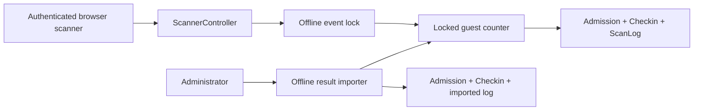

# Scanner architecture

Approved visual target (2026-10-30): references19/23/24/25/35/36/37 map to existing scanner pages and result states. Preserve actual camera/search/count/confirm/Scan Next contracts, current event checks and offline behavior while adopting the [PangaEvents UI](REFERENCE_UI_IMPLEMENTATION.md) in its approved phase. Unknown/foreign tickets must not disclose sample guest details; browser torch/device telemetry require actual capability evidence. No new admission algorithm or Android implementation is introduced.

Initial audit: 2026-10-11, Phase 0/1; current-state notes reviewed 2026-10-19. **CURRENT** means present in source; **TARGET** is the requested architecture; **PLANNED** is later work; **REQUIRES VERIFICATION** is an evidence gap. See [API contract](API_CONTRACT.md), [offline protocol](OFFLINE_SYNC.md), and [Android status](ANDROID_SCANNER.md).

## Current authority and flow

**CURRENT:** The scanner is a Laravel browser application with session authentication, CSRF protection and exact `scanner` role checks. It resolves the event from the scanner's assigned event, then selected session event, then default event. Client `event_id` is not admission authority. The registered [API routes](../routes/api.php) provide token login/profile/logout only. They do not authenticate the existing browser scanner routes or provide versioned scanner/admission endpoints; Android client integration remains unverified. Sources: [routes](../routes/web.php), [bootstrap](../bootstrap/app.php), [ScannerController](../app/Http/Controllers/ScannerController.php), [role middleware](../app/Http/Middleware/EnsureUserHasRole.php).

The web workflow is dashboard → scan/validate → choose entry count → confirm → next scan; manual lookup and recent scans remain available. Camera operation on physical devices was not verified during this audit. [Views](../resources/views/scanner), [interface tests](../tests/Feature/ScannerInterfaceTest.php).

## Current browser endpoint contracts

All paths below are under `/scanner`; all require a web session and `scanner` role. Mutations require CSRF. These are existing browser contracts, not a new versioned mobile API. Rates are route throttle limits per minute.

| Method and path | Inputs | Result |
|---|---|---|
| GET `/` | None | Redirect to `/scanner/dashboard` |
| GET `/dashboard` | None | HTML; own event/user daily entry/scan counts and last 3 checkins |
| GET `/scan` | Optional query `token` | HTML scanner with initial token |
| GET `/ticket/{token}`, `/verify/{token}` | Path token | HTML scanner; GET `/verify/{token}` does not validate or admit |
| GET `/recent-scans` | Pagination | HTML; own event/user history, 15 per page |
| GET `/manual-search` | Optional `q` | HTML; exact 4-digit code or normalized phone, assigned event only, up to 12 results; name search unsupported |
| POST `/manual-admit` | Required integer `guest_id >= 1`, `entries_to_admit` 1–10; optional string `search` ≤120 | 302 to manual search with success flash or `entries_to_admit` error; 60/min |
| POST `/validate` | At least one nullable string `qr_token` / `scanned_url`, each ≤2048; token takes precedence | JSON described below; 180/min |
| POST `/verify` | Required string `token` ≤2048 | JSON described below; 180/min |
| POST `/admit` | `qr_token` or `token` ≤2048; `entries_to_admit` or `quantity` integer 1–10; optional `guest_id >= 1`, strings `admitted_by`, `device_label` ≤80 | JSON described below; 60/min |

Sources for all application response shapes: [ScannerController](../app/Http/Controllers/ScannerController.php). Alias pairs are not checked for equal values when both are supplied: `qr_token` and `entries_to_admit` win.

**POST `/validate`:** HTTP 200 for both business success and rejection. Success is `{status:"valid", guest_id, guest_name, phone_number, pass_type, allowed_entries, used_entries, remaining_entries}`; `pass_type` is the stored key. Failure is `{status, message}` with status `invalid`, `wrong_event`, `revoked`, `cancelled`, or `already_used`. Validation records a Checkin and ScanLog without incrementing admission counts.

**POST `/verify`:** A found, same-event guest returns HTTP 200 `{ok, result, message, guest, token}`. `result` is `valid`, `revoked`, `cancelled`, or `already_used`; `ok` indicates admission eligibility. Unknown token: HTTP 404 `{ok:false,result:"invalid",message}`. Missing guest: HTTP 404 additionally includes `status:"invalid"`. Wrong event: HTTP 409 `{ok:false,result:"wrong_event",status:"wrong_event",message}`. Verification also records a Checkin and ScanLog.

**POST `/admit`:** Success: HTTP 200 `{ok:true,status:"admitted",result:"admitted",message,guest}`. Business errors use `{ok:false,status,result,message}` and may include `guest` once an authorized guest is found. Codes: 404 `invalid` for absent token/guest; 409 `wrong_event`, `revoked`, `cancelled`, `already_used`; 422 `invalid` for empty canonical token or mismatched `guest_id`; 422 `error` for allowance above 10 or requested entries above remaining allowance. Atomic-update failure may return `guest:null`.

The nested `guest` object contains `id`, `guest_name`, `phone_number`, `pass_type` (display label), `pass_type_key`, `allowed_admissions`, `admitted_count`, `remaining_admissions`, `allowed_entries`, `used_entries`, `remaining_entries`, `usage_status`, `system_status`, and `token_preview` (last 8 token characters). Preserve these compatibility aliases until a separately versioned contract replaces them.

**Cross-cutting errors:** With JSON expected, framework validation yields 422 `{message,errors:{field:[messages]}}`; unauthenticated requests yield 401 and wrong role 403. Browser guests normally redirect to login. CSRF expiry returns 419 `{message:"Your session expired. Refresh the page and try that action again."}` for JSON. Throttle returns 429. Offline event lock returns 423 `{message}` for JSON or a browser redirect with flash error. Both validate routes and both admission routes are locked; dashboard/manual lookup/history reads remain available. Framework 401/403/429 text is not a stable machine code. [CSRF response](../bootstrap/app.php), [offline middleware](../app/Http/Middleware/EnsureLaravelAdmissionAllowed.php), [lock exception](../app/Exceptions/OfflineEventLockedException.php).

## Tokens, manual codes and transactions

**CURRENT:** QR token creation uses 64 random alphanumeric characters. Lookup validation accepts 40–128 alphanumeric characters. Canonicalization trims input, prefers a URL `token` query value, otherwise takes the final path segment, otherwise uses raw input; no origin allowlist or embedded guest PII is required. Offline identity is SHA-256 of the canonical token. Existing database QR tokens are plaintext bearer values; offline guest snapshots export their hashes. [Guest](../app/Models/Guest.php), [canonicalizer](../app/Services/QrTokenCanonicalizer.php), [snapshot builder](../app/Services/GuestSnapshotService.php).

Manual codes are strings `0000`–`9999`, event-scoped with a unique database constraint. They are lookup identifiers, not authentication credentials; capacity is 10,000 codes/event. Generation checks availability before insert, so concurrent creation can still collide at the database constraint. [ManualCodeService](../app/Services/ManualCodeService.php), [migration](../database/migrations/2026_06_02_120000_add_manual_code_to_guests_table.php).

Admission uses a transaction with three deadlock retry attempts, locks event/offline session first, then QR/guest for QR admission or guest for manual admission. A conditional SQL increment enforces `used_entries + quantity <= allowed_entries`, allowed ≤10, and non-cancelled state. The transaction writes Admission, Checkin and ScanLog together. Stale validation is rechecked during confirmation. [Admission tests](../tests/Feature/ScannerConfirmAdmissionTest.php), [manual tests](../tests/Feature/ScannerManualSearchTest.php).

**CURRENT RISK:** Online admission has no request UUID/idempotency key. Retrying a lost successful response can consume another entry while capacity remains. Row locks prevent exceeding the allowance; they do not identify a repeated business request. The event row lock also serializes admissions across different guests in the same event; measure throughput before changing lock order.

## Duplicate logic and target boundary

**CURRENT:** No shared `AdmissionService` exists. Rules and side effects are distributed among `ScannerController::validateQr`, `verify/resultFor`, `manualAdmit`, `admit/applyAdmissionToLockedGuest`, [Guest](../app/Models/Guest.php), [offline importer](../app/Services/OfflineScannerResults/OfflineScannerResultsImporter.php), and [conflict resolver](../app/Services/OfflineScannerResults/OfflineScannerImportConflictResolver.php). The [offline admission applier](../app/Services/OfflineScannerResults/OfflineScannerAdmissionApplier.php) only upserts historical Admission/Checkin rows; it does not validate or update guest counters.

Concrete differences: validate checks allowed guest statuses; verify has a weaker status check; admit bypasses the lookup token-format regex; manual admission can work without a QR row whereas offline snapshots disable missing QR passes; failed manual business checks do not record scans; offline imports retain non-admission audit rows separately and do not create ScanLog rows. Conflict acceptance checks event/capacity/duplicate provenance but does not apply the web cancelled/revoked guards. Reconciliation may need explicit overrides; those must remain deliberate and audited rather than accidental differences.

**TARGET:** One authoritative admission domain service used by browser and future Android API, with explicit event authorization, bounded counters, transactions, request idempotency, common outcomes and audit records. Keep transport response compatibility in adapters. Reconciliation is a separate authorized command with documented override policy, not unrestricted reuse of ordinary admission.

**PLANNED:** Phase 13 service extraction follows tenant authorization work and characterization of existing behavior; Phase 14 introduces versioned Android API contracts. Reuse token, phone, manual-code, lock, snapshot, file and reconciliation services. Do not rewrite the scanner or silently change `.wqrpkg`/`.wqrresults` contracts.

## PLANNED — personal invitation and RSVP ticket integration (2026-10-25)

The [guest invitation page](RSVP_AND_GUEST_TICKETS.md) adds a way to view the existing pass. It does not add an admission engine. Its opaque invitation access token is a separate, limited capability for one event/guest's invitation, RSVP and permitted ticket; it is not a new QR admission token, a scanner login or a four-digit manual lookup code. Public invitation routes must not expose `/scanner/*` or create a scanner session for a guest.

After an affirmative RSVP, show **Tiketi Yako / Your Ticket** with the guest's name, event/date/location, existing QR, configured allowed entries, optional table assignment and **Onyesha mlangoni / Show at Entrance**. Read the exact `qr_codes.guest_id → guests.event_id → events.workspace_id` lineage under the guest capability and current access rules. Reuse `QrCodeService` / `GuestQrImageService` rendering responsibilities without public-GET writes: the current guest image helper can save a missing manual code, so a read-only projection must refuse unavailable credentials rather than call that repair path. Do not mint a second QR, regenerate a token on RSVP, create an invitation-only guest or substitute the invitation URL for the existing admission payload. Protected rendering/file delivery must address current public-storage exposure before release.

| Concept | Compatibility rule |
|---|---|
| RSVP | `attending` / `not_attending` records intent; it never changes `used_entries`, pass type or admission history |
| Default ticket policy | Existing-pass behavior remains the default: an otherwise valid pass is independent of pending, affirmative or declined RSVP |
| Optional future release policy | `after_positive_rsvp` may control ticket visibility after explicit event-level selection and approved migration rules; hiding a ticket is not revoking previously downloaded passes |
| Single | Show and enforce 1 allowed entry |
| Double | Show and enforce 2 allowed entries |
| Special / Family | Show and enforce the existing configured allowance, at most 100; no new unlimited family pass |
| Actual admissions | Continue reading authoritative used/remaining entries and admission records; confirmation totals never serve as admission counters |

Missing/revoked/cancelled or fully consumed pass states need explicit guest-facing feedback; an RSVP must not repair, reset or reactivate them. Decline/change of response preserves QR/manual code and historical entry data. Any future change to scanner eligibility based on RSVP is a separately approved, audited product/migration change, not an implicit consequence of ticket display settings.

P19-UX-03 depends on Phase 5 admission contracts and Phase 13 backend unification as well as protected guest access. Existing browser `validate → choose count → confirm → Scan Next` and manual fallback stay compatible. The future Android scanner uses that same authoritative admission service and shared identity, retaining existing offline protocol/version rules; actual Android integration remains unverified. The current implementation is still `ScannerController` plus offline importer/conflict logic, not an already delivered `AdmissionService`.

Acceptance must scan the ticket's exact existing token into the correct event, verify guest and allowance, admit only the requested permitted entries, preserve partial/fully used outcomes, reject wrong-event/revoked passes and prevent over-admission under concurrent QR/manual requests. Preserve online retry-idempotency and offline reconciliation work as explicit dependencies; RSVP does not solve them. Test pending/yes/no/change-of-response with an existing valid pass and a partly used family pass, proving QR/manual codes and admission rows remain unchanged by every RSVP operation. The owner dashboard displays confirmations separately from admitted entries, remaining capacity, fully used passes and partial passes. See [end-to-end acceptance](TEST_STRATEGY.md).

## Verification boundary

Historical Phase0/1 baseline: **197 tests, 1,575 assertions, 196 passed, 1 failed**, with unauthenticated scanner HTTP redirect reaching login before HTTPS. **IMPLEMENTED update (P2-001, 2026-10-12):** middleware priority now places scanner HTTPS before authentication; the former [ScannerInterfaceTest](../tests/Feature/ScannerInterfaceTest.php) failure and new secure/localhost/login tests pass in the full **227-test / 1,768-assertion** suite. The [HTTPS middleware](../app/Http/Middleware/RedirectScannerToHttps.php) remains conditional on HTTPS app.url and exempts localhost. Scanner admission/JSON behavior is unchanged. Real camera UX, production MySQL contention and live database/HTTPS state remain **REQUIRES VERIFICATION**.

## IMPLEMENTED — P3-010 selected admission evidence (2026-10-19)

Five selected cases passed on a separate MySQL 8.4.11 server using ten independent PHP workers and five fresh synthetic databases, each with 27 repository migrations and 31 tables. Four last-entry pairs (QR/QR, manual/manual, QR/manual and manual/QR) showed actual owned-thread lock waits and precommit invisibility. Each pair committed exactly one admission, rejected the other attempt and ended at used_entries=3, allowed_entries=3, with no overshoot. The guest counter increase, new Admission quantity and successful Checkin entries all equalled one. Prior historical rows were preserved exactly. QR rejection added a zero-entry Checkin and a verify ScanLog; manual rejection added neither, preserving existing response/audit differences. Every other table/record and immutable guest, manual-code, QR, account and offline-provenance field matched the fixture snapshot. Terminating only the identity-verified owned PHP holder after its uncommitted guest-counter UPDATE caused MySQL to roll back the counter/status change and leave history unchanged. Its connection thread disappeared, the complete prior committed snapshot returned, and a fresh worker then admitted exactly once. These are selected existing-route transaction cases on synthetic data, not exhaustive concurrency, hosted-engine, throughput, browser/camera/device, offline interoperability or customer tenant-isolation proof. Online admission still has no request idempotency key: retrying a lost successful response can consume more allowance while capacity remains. Existing event-row serialization is unchanged. Real ownership/platform approval, customer database/private-file restore, maintenance fencing and runtime tenant policies remain open; Phase 3 remains IN PROGRESS. [Scope and evidence](MYSQL_ADMISSION_REHEARSAL.md).
